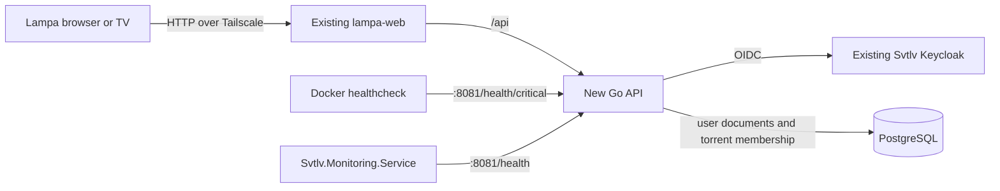

# Lampa Svtlv User Data Persistence Design

Status: Implemented

Date: 2026-09-15 (authentication and Account UI decisions added 2026-09-24;
Plan 3 storage and TorrServer decisions updated 2026-10-14;
Plan 4 user-data synchronization implemented 2026-10-20)

Target branch: `svtlvtv`

## 1. Decision

Add a small Go backend that stores one Lampa user-owned data document per signed-in
user. Device settings stay on each device.

The server holds the shared state for signed-in users:

1. On first login, fetch the server document. If it exists, clear guest or another
   user's synchronized values and apply the server values; otherwise keep guest
   data for the first upload. Never copy another account's data.
2. On later starts, apply server values before Lampa boots, preserving unsaved
   local edits identified by persistent per-key fingerprints.
3. While running, poll with an ETag every 60 seconds while visible, on screen
   return and before saving. Apply remote changes live, including during playback.
4. Save the latest server document overlaid with dirty local keys, guarded by
   `If-Match`. Retry a conflicting save once after polling again.
5. On logout or confirmed expiry, clear synchronized values and ownership metadata;
   device settings remain local (§16).

Anonymous user data stays in browser storage and no user-data request is sent
to the backend. Plan 3 separates guest My Torrents through device-local
membership (§10.4) and the fork removes TrackTimecode's shared TorrServer timecodes; other optional
external services keep their current behavior.

## 2. Scope

Persist durable user-owned data already saved by Lampa, including:

- portable content and account preferences;
- favorites and bookmarks;
- scores and reactions;
- subscriptions;
- watched state and playback progress;
- useful history;
- other durable personal data discovered during the ownership audit (§10.3).

Keep playback engines, hardware and device-specific network configuration,
temporary caches, current navigation state, device-detection values, temporary request data and
authentication tokens owned by another service out of the user document. The
scope of each concrete storage key is defined in §10.3 before synchronization.
TorrServer's own saved torrents are separate from browser storage
and require the handling in §10.4.

TorrServer and Jackett remain unchanged and the browser calls them directly;
the API does not proxy their traffic. Plan 3 reduces Lampa's built-in TorrServer
settings to one URL through a small, marked `app.min.js` patch and a matching
`assembly.json` stamp. Account, ownership and synchronization integrations stay
in `svtlv/`; compiled stylesheets and upstream language files remain unchanged.
Upstream bundle updates require reapplying the one-link patch (§10.2).

## 3. Architecture



Components:

- `lampa-web` continues serving the existing static application and proxies
  `/api/v1/` to the Go service (Apache `mod_proxy_http` inside the `lampa-web`
  image, added in Plan 2).
- `lampa-api` handles login, sessions, user-data reads and writes, and
  authenticated torrent-membership operations.
- the existing Svtlv Keycloak identifies the user.
- PostgreSQL stores the complete user document in JSONB (login sessions are
  stateless cookies, §5.3).
- a small ES5 Account add-on (`svtlv/account.js`, Plan 2) adds sign-in,
  sign-out and the header avatar to Lampa through its public API (§10.5).
- an ES5 ownership add-on (`svtlv/torrserver-ownership.js`, Plan 3) wraps
  the public `Lampa.Torserver` methods before My Torrents can render (§10.4).
- an ES5 synchronization add-on (`svtlv/account-sync.js`, Plan 4) reads the
  runtime whitelist, applies data before boot, and polls and saves after boot (§6).

The frontend adapter is required because a backend cannot directly read or
update browser `localStorage`.

### 3.1 Go engineering baseline: Ralphex

Use Ralphex as the engineering baseline for the new Go module. The baseline
inspected for this design is Ralphex `master` at commit `a736d5e`; re-check its
current `master` at the start of Plan 1 so the Go version and pinned tool
versions do not drift accidentally.

Ralphex is the reference for project structure, code style and quality checks,
not for Lampa's business architecture. Do not copy Ralphex CLI, dashboard or
executor dependencies into this service unless the backend actually needs
them.

Keep the Go module additive and isolated from upstream Lampa files:

```text
backend/
├── cmd/lampa-api/       # composition root and process lifecycle
├── pkg/api/             # HTTP routes, middleware and response contract
├── pkg/auth/            # Keycloak OIDC and session handling
├── pkg/config/          # typed environment configuration and validation
├── pkg/health/          # Svtlv-compatible health reports
├── pkg/storage/         # user-data service and PostgreSQL implementation
├── migrations/          # versioned PostgreSQL schema
├── Makefile
├── go.mod
├── go.sum
└── vendor/
```

Follow these Ralphex conventions:

- use the same pinned Go toolchain in `go.mod`, CI and the Docker builder
  (`go 1.26.0` in the inspected baseline);
- use `cmd/<binary>` for the entry point and small `pkg/<responsibility>`
  packages, with private internal state and explicit constructors;
- prefer the standard library, including `net/http`, and add a dependency only
  when it directly reduces necessary implementation work;
- define narrow interfaces in the consuming package, pass `context.Context` as
  the first argument to blocking or cancellable operations, and generate mocks
  with `moq` into a `mocks/` subdirectory when a generated mock is useful;
- wrap errors with operation context and `%w`, validate constructor/configuration
  inputs, set explicit HTTP timeouts, and shut the server down through a bounded
  context;
- use a small injected logger interface where test isolation requires it and
  never log user documents or secrets;
- use lowercase comments except for exported Go documentation comments;
- commit `go.mod`, `go.sum` and `vendor/`; after dependency changes run
  `go mod tidy` and `go mod vendor`.

Configuration should use typed structs, defaults and startup validation in the
same style as Ralphex, without copying Ralphex's CLI-specific `go-flags`
configuration. The files follow Svtlv's `appsettings` layering:

- `appsettings.json` holds the shared defaults and `appsettings.<Environment>.json`
  overrides only what differs (database location and Keycloak realm). Both are embedded
  with `//go:embed` and decoded strictly into one struct, so an unknown key is an
  error;
- the environment comes from `LAMPA_ENVIRONMENT` (`Development`, `Test` or
  `Production`, default `Test`). Development is a local `go run` against the
  database published on loopback `5434`;
- secrets are `{ENV_VAR}` placeholders (`{LAMPA_DB_PASSWORD}`,
  `{LAMPA_API_DATA_KEY}`, `{LAMPA_KEYCLOAK_CLIENT_SECRET}`) resolved from the
  environment. `Authentication.Keycloak.Authority` is a checked-in setting. Missing secrets fail startup naming the variable,
  never the value. No other environment variable overrides a file setting.

Ports follow the Svtlv series without colliding with it: the API listens on
`5800` inside the Compose network and is reached only through the `lampa-web`
`/api/v1/` proxy (not published since Plan 2), health stays on the
container-internal `8081`, and PostgreSQL is published only on
`127.0.0.1:5434` (Svtlv uses `5433`, Keycloak `8080`).

The backend quality contract is:

- provide Ralphex-style `make build`, `make test`, `make lint`, `make fmt` and
  `make race` targets inside `backend/`;
- `make test` runs all packages with the race detector and a coverage profile;
- tests use the standard `testing` package plus `testify/assert` and
  `testify/require`, table-driven subtests, `httptest` for HTTP handlers,
  `t.Helper()` in helpers and `t.TempDir()` for filesystem work;
- keep one matching test file per source file (`foo.go` -> `foo_test.go`) and
  target at least 80% coverage for new backend code, excluding generated mocks;
- start from Ralphex's GolangCI-Lint v2 configuration, using the same enabled
  linters and settings, and pin the same linter version in CI (`v2.13.0` in the
  inspected baseline); copy only exclusions that apply to this service and
  explain every Lampa-specific suppression;
- CI runs the same race, coverage and lint checks before building an image;
  tool/action versions are pinned rather than floating silently;
- use a multi-stage Docker build with revision metadata and a minimal non-root
  runtime image.

The Ralphex commands and configuration are the source of truth when the plan is
implemented. If a Lampa-specific need requires a deviation, record the reason
in that implementation plan. Ralphex's automatic CI/release triggers are not
copied: Lampa production deployment remains `workflow_dispatch` only.

## 4. Data model

One row stores each Keycloak user's schema-version-2 document. The current schema,
following migrations `00001` and `00003_user_data_v2.sql`, is:

```sql
create table lampa_user_data (
    user_id uuid primary key,
    schema_version integer not null,
    data jsonb not null,
    etag text not null default '',
    created_at timestamptz not null default now(),
    updated_at timestamptz not null default now()
);
```

`user_id` comes only from the session's Keycloak `sub`. Migration `00003` drops
`encrypted_connections` and adds `etag`; version-1 rows read as absent (`404`),
and version-1 PUT bodies are rejected. There is no conversion of old documents.

The wire envelope is `{schema_version: 2, data: {...}, encrypt?: [...]}`. `data`
is an object with keys matching `^[A-Za-z0-9_.:-]{1,128}$` and arbitrary JSON
values: strings, numbers, booleans, null, arrays and objects. There are no fixed
sections or per-section limits. The optional `encrypt` array contains at most
64 keys matching the same pattern. Listed keys absent from `data` are ignored.
Client values containing an object with a `$sealed` member, at any depth, are
reserved and rejected with `400 invalid_document`.

The add-on sends exact, nonempty `localStorage` strings, even for arrays and
objects. For example, a stored JSONB `data` object can contain:

```json
{
  "language": "ru",
  "favorite": "{\"book\":[],\"history\":[]}",
  "torrserver_url": "http://ts:8090",
  "torrserver_password": {"$sealed": "base64(nonce+ciphertext)"}
}
```

Each listed value is sealed in place with AES-256-GCM and `LAMPA_API_DATA_KEY`,
bound to the user ID. GET opens values before returning them; an unreadable
sealed value is omitted with a `[WARN]` log while the rest of the document is
returned. The backend has no secret-key list: `encrypt` is the client's choice.
The shipped whitelist selects only `torrserver_login` and `torrserver_password`.
Other connection credentials stay local (§10.3).

`etag` is the SHA-256 of canonical plaintext `data`, computed before sealing:
object keys sorted recursively, JSON compacted and escaped strings normalized.
It excludes `encrypt` and timestamps. GET and PUT return the stored tag quoted
in the `ETag` header. A conditional PUT updates only a row with the expected tag.

`Api.MaxBodyBytes` is 4194304 (4 MiB) for the complete encoded request;
maximum JSON nesting is 32, counting the envelope. Invalid UTF-8, NUL escapes,
unpaired surrogates and values PostgreSQL JSONB cannot store are rejected.
The add-on measures the UTF-8 size of the JSON envelope including escaping and
`encrypt`, then drops the largest encoded `user_optional` values first until it
fits. If must-sync values alone exceed the limit, or measurement fails, it
keeps local edits and notifies without uploading. Local optional quota failures
are skipped; a must-sync write failure disables sync for the page.

Plan 3's membership table remains independent, created by
`00002_create_lampa_torrserver_hashes.sql`:

```sql
create table lampa_torrserver_hashes (
    user_id uuid not null,
    server_id text not null check (server_id ~ '^[A-Za-z0-9_-]{1,64}$'),
    hash text not null check (hash ~ '^([0-9a-f]{40}|[0-9a-f]{64})$'),
    created_at timestamptz not null default now(),
    primary key (user_id, server_id, hash)
);
```

Deleting a user-data document never deletes memberships. Claims are idempotent
and preserve the original row; release deletes only the authenticated user's
row on that server. There is no row cap, foreign key to `lampa_user_data`,
automatic pruning or physical TorrServer cleanup. The critical database health
check probes both tables.

## 5. Authentication

Use the existing Svtlv Keycloak realm and its existing users. Create a separate
confidential OpenID Connect client named `svtlv-lampa`. Do not reuse the
`svtlv-web` client: users and Keycloak SSO are shared at realm level, while each
application keeps its own redirect URIs, client secret and session boundary.

Lampa initially requires only a valid authenticated user. It does not consume
Svtlv Web application roles. If Lampa-specific roles are ever needed, define
them as client roles on `svtlv-lampa`, not as dependencies on another client's
roles.

Anonymous use does not require a session.

### 5.1 Supported clients

Login is supported only where Lampa runs as the web deployment at the configured
public URL, same-origin with `/api`: a desktop or phone browser, a TV browser, or
a TV app that navigates its WebView to that address. The Android client in use,
[`lampa-app/LAMPA`](https://github.com/lampa-app/LAMPA), is such an app:
`MainActivity.onBrowserInitCompleted` calls `browser.loadUrl(LAMPA_URL)` with the
address typed into its URL dialog, so the document origin is the Lampa site and
first-party cookies apply (the app has no cookie code; WebView defaults accept
and persist them). Its saved address must equal the configured public URL.

The production deployment is reachable only inside the Tailscale network, at
`http://svtlv:8092` (bound to `100.105.140.19:8092`). WireGuard encrypts that
link, but browsers treat it as plain HTTP: a `Secure` cookie is never stored
there. So every Lampa cookie (session, login and device flow) carries `Secure`
only when the public URL is `https://`; `HttpOnly` and `SameSite=Lax` always
apply. The release Compose file binds the Lampa port to the Tailscale address;
the deploy workflow verifies that mapping before deploying.

Keycloak may likewise be reached over HTTP inside the tailnet. The configured
issuer must equal, character for character, the `iss` Keycloak puts in its
tokens: a realm with a fixed public HTTPS hostname issues `https://…` even when
it is fetched over a Tailscale address, so the issuer is taken from the
discovery document the API container actually reads (Plan 2 pre-flight). The
backend then calls the token, device and JWKS endpoints exactly as that
document advertises them, and users open its authorization and verification
URLs, so all of those must be reachable. The shared `svtlv` realm's
hostname/issuer is not changed for Lampa: other Svtlv clients depend on it. With
an HTTP issuer the phone used for the TV device login must be on the tailnet
too, since the QR code points at Keycloak's verification page.

Moving Lampa to HTTPS later (`tailscale cert` / `tailscale serve`, or a real
certificate) needs TLS set up at Apache, the new `https://…/api/v1/auth/callback`
and `https://…/` post-logout redirect registered in Keycloak, and the address
saved on every device updated. Apache must pass the browser-facing scheme to the
API; the `Secure` cookie flag then follows automatically.

Shells whose document runs from `file://` or an app origin and only load
`app.min.js` remotely (`index.html` `AndroidJS.getLampaURL()` branch, packaged
Tizen/webOS widgets) are not supported: the Account add-on hides itself when
`location.protocol` is not `http:`/`https:` (§10.5), and those shells keep
working anonymously. Supporting file/app origins would need a bearer token
stored in Lampa storage,
which every plugin can read; a stolen token exposes the user document, including
credentials decrypted by `storage.Service.Get`, so it is deferred to a separate decision with explicit
risk acceptance. Credentialed CORS and `Origin: null` are never allowed: any site
can produce a null origin from a sandboxed iframe.

### 5.2 Login flows

Both flows run in the Go backend with `github.com/coreos/go-oidc/v3` and
`golang.org/x/oauth2` (vendored); no hand-written JWT validation. The browser
never receives a readable Keycloak token: only the refresh token is kept, sealed
inside the `HttpOnly` session cookie (§5.3).

The flow is chosen in the browser with Lampa's `Platform.tv()` — the same split
CUB's own login uses (QR on TV, mobile layout otherwise). `Platform.screen('tv')`
is not used: it is also true for non-touch desktop browsers.

- **TV (`Platform.tv()` true): OAuth 2.0 Device Authorization Grant (RFC 8628).**
  1. `POST /api/v1/auth/device/start` — the backend calls Keycloak's device
     endpoint and returns `user_code`, `verification_uri`,
     `verification_uri_complete`, `expires_in` and `interval`. The backend sends
     an S256 PKCE challenge. The secret `device_code` and PKCE verifier are sealed
     into a short-lived `HttpOnly` cookie scoped to `/api/v1/auth/device`; neither
     reaches the browser in plaintext.
  2. The TV shows a QR code of `verification_uri_complete` and the `user_code`
     (layout of CUB's `account-modal-split` window, without its keypad) with a
     pending status and the expiry countdown.
  3. The user scans the code and signs in to Keycloak on a phone.
  4. The TV calls `POST /api/v1/auth/device/poll` every `interval` seconds. The
     backend exchanges the sealed `device_code` with its PKCE verifier at Keycloak's
     token endpoint:
     `authorization_pending` → `202 {"status":"pending"}`; `slow_down` → `202`
     with a larger interval; `expired_token` → `410`; `access_denied` → `403`;
     success → the ID token is verified, the session is created and the response
     sets the session cookie.
- **Phone and computer: Authorization Code flow with PKCE (S256), state and
  nonce.** `GET /api/v1/auth/login?return=<path>` redirects to Keycloak;
  state, nonce, PKCE verifier and the return path travel in a sealed,
  `HttpOnly`, 10-minute cookie scoped to `/api/v1/auth/callback`.
  `GET /api/v1/auth/callback` verifies them and the ID token, creates the
  session and redirects to the return path, which must be a local absolute path
  (no scheme, host or `//`).

Cookie sealing keys are derived from `LAMPA_API_DATA_KEY` with HKDF-SHA256 and a
distinct purpose label per use, so no new secret is needed and the data-at-rest
key is never used directly for cookies.

### 5.3 Sessions

Sessions are stateless: the whole session lives in one sealed cookie and the
server keeps no session state (decided 2026-09-26; no table, no purge job).
Every authenticated request is revalidated against Keycloak, so ending the
Keycloak session, disabling or deleting the user signs them out of Lampa on
their next request (decided 2026-09-27; §5.3.1).

- the `lampa_session` cookie is AES-256-GCM sealed JSON
  `{sub, name, email, picture, created_at, idle_expires_at, refresh_token,
  refreshed_at, refresh_expires_at}`; the key is derived
  from `LAMPA_API_DATA_KEY` with HKDF-SHA256 and the purpose label
  `lampa-session-v1`, so the browser can neither read nor forge it;
- `HttpOnly`, `SameSite=Lax`, `Path=/api`, `Secure` only when the public URL
  is HTTPS (§5.1), with
  a real `Max-Age`. A session-only cookie could vanish on an app restart;
- lifetime is the app's own: sliding 30-day idle timeout, 180-day absolute
  cap. Re-login with a remote is costly, so TV sessions must last. Keycloak can
  only end a session earlier (§5.3.1), never extend it;
- the idle timeout slides only when the cookie is re-issued: `GET
  /api/v1/session` first rejects a cookie past `idle_expires_at` or past
  `created_at + 180 days`, then re-issues it with `created_at` preserved and
  `idle_expires_at = min(now + 30 days, created_at + 180 days)`, `Max-Age`
  matching. The add-on calls it at start and every 12 hours, so a TV left
  running keeps its session; other API requests validate and revalidate
  (§5.3.1) but re-issue the cookie only after a Keycloak refresh;
- after the ID token is verified the backend keeps only `sub`, `name`
  (falling back to `preferred_username`), `email` and the optional `picture`,
  all inside the cookie, plus the refresh token from the same token response.
  The access and ID tokens are discarded. The final `name=value` stays within
  4000 bytes after JSON escaping, sealing and base64 (browsers cap one cookie at
  4096; the whole serialized `Set-Cookie` value, attributes included, is
  bounded on issue and on every re-issue); an over-long `picture` URL is
  dropped, never truncated, names are length-limited, and the refresh token is
  never dropped or truncated: if it still does not fit, the login fails and is
  logged (after a refresh, the existing session is kept);
- `POST /api/v1/auth/logout` clears the session and in-progress login cookies on
  this device. On a TV it ends only the local session. A browser uses `?sso=1`
  to end the associated Keycloak session through the refresh token and then
  follows Keycloak's end-session URL to clear the browser SSO cookie. This signs
  out Svtlv apps sharing that browser session, while other browsers keep their
  sessions. A TV approved from that browser may share the same Keycloak user
  session and be signed out too. It also sets a
  `lampa_logout` cookie holding the logout time (`Path=/api`, `Max-Age` = the
  absolute timeout, unsealed: it only affects the sender's own sessions), and a
  session created up to that time is refused, so a request of another tab still
  in flight cannot sign the device back in with a renewed cookie; the next login
  deletes it;
- accepted costs of stateless sessions: a copied TV cookie stays valid after
  local logout until its Keycloak session ends or the cookie expires; revocation is
  done in Keycloak, and ending one Keycloak session revokes every app session
  tied to it (browser logins on one device can share one SSO session); the
  profile (including the avatar) refreshes on the next login. Revoking every session at once is a code
  change that bumps the purpose label (`lampa-session-v2`) — never a rotation of
  `LAMPA_API_DATA_KEY`, which also seals user data at rest;
- sessions, `GET /api/v1/session` and local logout work with the database down;
  they keep working with Keycloak down too (§5.3.1). Browser SSO logout needs Keycloak;
- the `Authenticator` seam (`api.Authenticator`) is implemented in `pkg/auth`:
  it opens the cookie, checks both expiries, revalidates (§5.3.1) and returns
  `sub`. A missing, tampered, expired or revoked cookie is
  `ErrUnauthenticated` (a revoked one is also cleared); the `authenticate`
  middleware answers `401` for it and `503 session_unavailable` for any other
  error, so a client is never told it is signed out because a dependency failed.

### 5.3.1 Revalidation against Keycloak

Decided 2026-09-27: ending a user's Keycloak session (admin console "Sign
out", or the session expiring), disabling or deleting the user signs them out
of Lampa on their **next** authenticated request (`/api/v1/session` or any
user-data call), while the 30/180-day lifetimes above stay the app's.

- every authenticated request makes one revalidation call to Keycloak with the
  sealed refresh token (the first use after a restart may add a discovery
  call), using the client credentials, an overall 3-second timeout and
  redirects disabled. No success is cached: a cache would delay revocation;
- established libraries do the protocol work (decided 2026-09-27): the refresh
  grant goes through `golang.org/x/oauth2`, the same library the login flows
  use. It does not expose token introspection, and the
  `github.com/zitadel/oidc/v3` helper omits `token_type_hint` (without it
  Keycloak treats the token as an access token), so introspection is one small
  `net/http` request. What stays ours is
  the policy: when to call, and that only an explicit "no" signs out;
- **refresh is due** when `now >= refreshed_at + min(1 day, (refresh_expires_at
  - refreshed_at) / 2)`. Then the call is a `refresh_token` grant, which also
  validates, slides Keycloak's SSO idle timer and returns a new refresh token;
  the cookie is re-issued with it (`created_at` preserved, `idle_expires_at`
  slid only by `/session`). Otherwise the call is token introspection
  (`token_type_hint=refresh_token`, endpoint from discovery), which neither
  slides the SSO idle timer nor consumes a token reuse. Keycloak 26.5.7 `RefreshTokenIntrospectionProvider` checks
  the user session and that the user exists and is enabled;
- **outcomes**: introspection `200` with `active: false`, or refresh `400
  invalid_grant` → signed out (cookie cleared, `401`, or anonymous `/session`).
  Introspection `200` with `active: true`, or refresh `200` carrying a
  non-empty refresh token and a positive `refresh_expires_in` → valid.
  Anything else (timeout, network error, another status, a malformed or
  incomplete body, an `active` that is not a JSON boolean, `invalid_client`)
  is a Keycloak failure: the session **keeps
  working** (user decision) and a `[WARN]` is logged. A Keycloak outage
  therefore breaks new logins only, and a user disabled during an outage keeps
  access until Keycloak answers again. During an outage each request waits up
  to the timeout;
- the `refresh_token` grant can run concurrently for one cookie (tabs, parallel
  requests). That is harmless only with the realm's **Revoke Refresh Token
  off**, which is therefore a deployment prerequisite, not an assumed default;
- Keycloak prerequisites (Post-Completion): realm SSO Session Idle ≥ 31 days
  (one day of slack over the app's 30, since Keycloak's idle timer slides only
  on a refresh) and SSO Session Max ≥ 180 days; client session idle/max unset
  or no shorter; Revoke Refresh Token off; `offline_access` never requested (an
  offline token outlives the SSO session, defeating revocation). The 30/180
  days are caps, not guarantees: a phone's SSO session may have started before
  the Lampa login, so Keycloak's max can end it earlier;
- cookies issued before this change have no refresh token and are rejected
  (one re-login).

Sync polling adds one authenticated GET per visible device every 60 seconds,
on screen return and before each save. Even a `304` revalidates the session.
A normal save uses a poll GET plus a PUT, hence two revalidation calls; a
`412` retry adds another GET and PUT. Concurrent triggers share an in-flight
poll. Hidden pages stop the periodic poll but can flush a save. There is no
revalidation cache; this load for a few devices is accepted. Keycloak outages
can therefore delay each poll or write by up to the revalidation timeout.

### 5.4 Avatar

The avatar follows Svtlv: Keycloak's `profile` scope omits `picture` unless a
client mapper adds it, so its absence is the normal case. With a `picture`
user-attribute mapper on `svtlv-lampa`, the URL comes from the ID token; without
it the add-on draws the user's initials.

### 5.5 CSRF

Every state-changing route (`POST`, `PUT`, `DELETE` — logout, device start/poll,
user data and torrent membership) requires the header `X-Lampa-Csrf: 1`. Any XHR
can set it (including jQuery on Safari 5.1-era TV engines); a cross-site form cannot, and a cross-origin
script would need a CORS preflight the API never grants. In addition a request
whose `Origin` header is present and differs from the request's scheme and Host is
rejected. A missing `Origin` or `Sec-Fetch-Site` alone never rejects a request,
because old TV engines send neither. Plugins run same-origin and can set the
header; CSRF protection cannot isolate them, and SECURITY.md already treats
plugins as untrusted code.

### 5.6 Keycloak client

`svtlv-lampa` in the `svtlv` realm: confidential client, Standard flow on,
"OAuth 2.0 Device Authorization Grant" on, direct access grants off, valid
redirect URI `<origin>/api/v1/auth/callback` and post-logout redirect URI
`<origin>/` for every browser-facing host (exact Keycloak registrations), no web origins
(the browser never calls Keycloak with CORS). Optional: a `picture`
user-attribute mapper (§5.4). The backend is configured with the realm issuer
URL, the client ID and the client secret (`{LAMPA_KEYCLOAK_CLIENT_SECRET}`).

## 6. Synchronization behavior

`svtlv/account-sync.js` is the only caller of the user-data API in the frontend.
It reads the whitelist at runtime and observes the Account add-on's
`svtlv_account_state` and `svtlv_account` state events after `window.Lampa` exists.
It polls for Lampa rather than installing an accessor on `window.Lampa`.

### 6.1 Anonymous startup

Without `localStorage['svtlv_sync_user']`, the pre-boot hook completes immediately
with no scope fetch or user-data request. A confirmed guest continues to use
local data; My Torrents uses device-local membership (§10.4).

The marker identifies whose synchronized data is on the device. A confirmed
guest with a marker clears synchronized values, base and marker, then reloads.
`checking` and `unavailable` leave data alone. Network failure never implies logout.

### 6.2 Login when server data exists

After `signed_in(U)`, fetch `/api/v1/user-data` with
`X-Lampa-Expected-User: U`. With no marker or another user's marker, clear all
synchronized keys and fingerprints before applying the document, including guest
keys absent from it. Apply only whitelisted string values; device keys stay local.
For the same user's marker, preserve dirty keys (§7).

Write marker and base before reloading, and reload only if anything was cleared
or changed. A login needs at most one reload; equal data enables uploads and
polling immediately. Repeated `signed_in` for the handled user does nothing.
Another tab's change to `svtlv_sync_user` reloads this page.

### 6.3 Login when server data does not exist

On `404 user_data_not_found`, a first login with no marker keeps guest data,
initializes the base and marker, and enables saving. If another user's marker
exists, clear that user's values first and reload if anything was cleared.
There is no cross-account import.

The first save polls, then sends the full local export without `If-Match` if
there is still no document. PUT answers `204` with the new ETag; fingerprints
are updated from the sent values. The former read-back GET is dropped.
Guest data is uploaded only when the account has no document, rather than
filling gaps in an existing server document.

### 6.4 Changes while signed in

Lampa keeps writing local storage normally. `Storage.listener` change events
for synced keys start a timer; they do not define which keys are dirty. A
must-sync edit waits 2 seconds; optional-only edits wait 5 minutes. Frequent
progress writes do not postpone an existing timer. Hiding the page flushes a
save, including on a page already hidden. Only one save runs at a time; a
trigger during that save requests one more pass.

Before saving, poll the latest document and apply clean remote changes. Overlay
only dirty local keys, enforce the encoded size rule (§4), and PUT with the
latest `If-Match`. A `412` polls and retries once. A `404` switches to a full
local export without `If-Match`. Successful PUT updates the base from the sent
values and retains its ETag, avoiding a download of the page's own write.

Live refresh polls every 60 seconds while visible and on return to visible.
Requests share an in-flight poll and use `If-None-Match: <lastEtag>`; `304`
changes nothing. On a valid `200`, apply only differing, non-dirty, whitelisted
string values, must-sync first. Write through `Lampa.Storage.set` with its
JSON rule (parse only leading `[` or `{`), preserving exact raw storage strings
for fingerprints. An `applying` guard prevents writes from scheduling a save.
Call `Lampa.Favorite.read()` after `favorite` changes and `Lampa.Timeline.read()`
after the key from `Timeline.filename()` changes. These updates happen without
a reload, also during playback. Hidden pages stop the periodic timer; logout
or `401`/`409` stops both polling and saves.

### 6.5 Later startup or refresh

The seam loads Account without waiting, then ownership, then sync, then invokes
`window.svtlv_sync_boot(done)` before `startLampa()`. The hook ignores a second
call and calls `done` exactly once. With a marker, it arms a 3-second deadline
before fetching scope and user-data in parallel. Late responses are ignored.
A signed-in boot can start downloading `app.min.js` up to 3 seconds later.

A valid v2 `200` applies raw values before Lampa initializes its storage cache,
protecting dirty keys. A `404 user_data_not_found` also marks sync ready.
`401`/`409` clears synchronized data and ownership metadata. Other errors,
invalid responses, timeout or scope failure let Lampa boot locally and retain
an after-boot notice; account handling can retry a failed boot fetch. A missing
or invalid whitelist after boot disables sync for that page. A missing or
throwing add-on always falls back to starting Lampa.

## 7. Conflict policy

The server stores one complete document, but the client merges by top-level key:
latest server copy plus dirty local values. Persistent
`localStorage['svtlv_sync_base']` maps keys to `length:32-bit-FNV-1a` fingerprints
of their last synchronized raw string. Empty string and null both mean no value.
A key is dirty whenever its local fingerprint differs from that base, including
changes written with `nolisten` (the language picker), after reload or failed saves.

Server apply skips dirty keys and updates the base for values it applies.
Successful PUT records fingerprints of the values actually sent, so another
edit during that request stays dirty. `If-Match` atomically protects an existing
row; a stale or missing row returns `412` and the client polls and retries once.
Independent keys survive concurrent saves. Changes to the same key use last
successful save wins, including a whole `favorite` or progress string. There
is no merge within a key, mutation log or tombstone table. Initial creation
without `If-Match` remains an unconditional upsert.

Clearing local values uses `''` to hide IndexedDB reserve copies (§16). Live
apply does not clear a key merely because it is absent from the server document;
login/account replacement and logout perform explicit clearing.

## 8. API

| Method and path | Purpose |
| --- | --- |
| `GET /api/v1/auth/login` | Start the Authorization Code login (phone, computer) |
| `GET /api/v1/auth/callback` | Finish that login and create the session |
| `POST /api/v1/auth/device/start` | Start the device login (TV); returns the user code and verification links |
| `POST /api/v1/auth/device/poll` | Poll the device login; creates the session when approved |
| `POST /api/v1/auth/logout` | End session |
| `GET /api/v1/session` | Return login status and the signed-in profile |
| `GET /api/v1/user-data` | `200` v2 document + `ETag`, or `304` without a body when `If-None-Match` matches |
| `PUT /api/v1/user-data` | `204` + new `ETag`; conditional replacement with `If-Match`, otherwise upsert |
| `DELETE /api/v1/user-data` | `204`, idempotently delete the signed-in user's cloud document |
| `GET /api/v1/torrservers/{server_id}/hashes` | `200 {"hashes":[...]}`, sorted; an empty array when this user has no claims |
| `PUT /api/v1/torrservers/{server_id}/hashes/{hash}` | `204`, idempotently claim a successfully added torrent; no body required |
| `DELETE /api/v1/torrservers/{server_id}/hashes/{hash}` | `204`, idempotently remove only this user's claim, never the TorrServer record |
| `GET :8081/health` | Return all critical and advisory health checks |
| `GET :8081/health/critical` | Return only Docker-critical health checks |

Example PUT body (`Content-Type: application/json`, `X-Lampa-Csrf: 1`):

```json
{
  "schema_version": 2,
  "data": {
    "language": "ru",
    "torrserver_url": "http://ts:8090",
    "torrserver_login": "user",
    "torrserver_password": "secret",
    "favorite": "{\"book\":[],\"history\":[]}"
  },
  "encrypt": ["torrserver_login", "torrserver_password"]
}
```

A successful GET returns `{schema_version: 2, data: {...}, updated_at: ...}`
with decrypted values and a quoted `ETag` header. `encrypt` is a PUT instruction,
not a GET field. GET keeps `Cache-Control: no-store`, including on `304`.
`If-None-Match` compares the tag ignoring a `W/` prefix. PUT with `If-Match`
compares likewise and returns `412 precondition_failed` if the row is absent
or changed; no storage write occurs. PUT without the header upserts. A successful
PUT returns `204` with no body and the new quoted ETag; DELETE is idempotent `204`.

User-data errors include `404 user_data_not_found` (including v1 rows),
`400 invalid_json` / `invalid_document` / `unsupported_schema_version`,
`413 request_too_large`, `415 unsupported_media_type`, `401 unauthenticated`,
`409 account_changed`, `412 precondition_failed`, and `503 storage_unavailable`
or `session_unavailable`. Modifying requests also enforce CSRF (§5.5).
Limits and reserved `$sealed` objects are described in §4.

`GET /api/v1/session` always answers `200`, anonymous or signed in, so an
anonymous start logs no error; a missing, tampered or expired cookie is simply
anonymous (sessions are stateless, §5.3):

```json
{ "authenticated": false }
```

```json
{
  "authenticated": true,
  "user": {
    "id": "4f1c…",
    "name": "User Name",
    "email": "user@example.com",
    "picture": ""
  }
}
```

The API requires authentication for every user-data and torrent-membership
operation, limits request size and never accepts a `user_id` from the request
body or URL. Membership operations must be idempotent. State-changing routes
require `X-Lampa-Csrf: 1` (§5.5).

The sync and ownership add-ons send `X-Lampa-Expected-User` with their captured
user ID on every user-data or membership request, respectively. GET, PUT and
DELETE user-data all check it before storage access. Omitting it preserves the
API behavior for other authenticated clients. This optional precondition never
establishes identity: a mismatch with the cookie-authenticated user returns
`409 account_changed` before accessing storage. The ownership add-on fails closed
and rechecks the session without replaying the operation. Sync stops saves and
polling and sends `svtlv_account {type: 'expired'}` for a session recheck on
`401`/`409`; it never retries under a new identity.
Inactive My Torrents components are discarded on account, URL or guest-storage
changes so returning from a detail screen rebuilds the filtered list.

Membership routes accept a `server_id` of 1–64 ASCII letters, digits,
underscores or hyphens. The add-on sends the SHA-256 ID described in §10.4;
the backend receives no TorrServer URL. Hashes are trimmed and lowercased,
then must contain 40 or 64 hexadecimal characters. Invalid parameters return
`400 invalid_server_id` or `400 invalid_hash`; authentication failures return
`401 unauthenticated` or `503 session_unavailable`, and storage failures return
`503 storage_unavailable`. PUT and DELETE also enforce CSRF. Access and panic
logs redact all paths starting `/api/v1/torrservers/` to
`/api/v1/torrservers/…`, including error paths, so neither server IDs nor hashes
are logged there. Access logs omit bodies, headers, cookies and query strings.

## 9. Health and Svtlv monitoring

The Go service must reproduce the existing Svtlv two-tier health contract even
though it cannot reference the .NET `Svtlv.Common.HealthChecks` library.

Both endpoints listen on container-internal HTTP port `8081` and are not
published to the host or proxied through the public Lampa origin. Their consumers
are intentionally separate: Docker Compose calls only `/health/critical`, while
`Svtlv.Monitoring.Service` calls only `/health`.

### 9.1 Endpoints

- `/health` runs every critical and advisory check. `Svtlv.Monitoring.Service`
  consumes this endpoint; operators may also use it for diagnosis.
- `/health/critical` runs only critical checks. It is used exclusively by the
  Docker Compose healthcheck.
- health endpoints require no user login because they are private network
  endpoints.

Initial checks:

| Check | Tier | Meaning |
| --- | --- | --- |
| `database` | Critical | PostgreSQL is reachable and the required schema is usable |
| `keycloak` | Advisory | Keycloak discovery/login dependency is reachable |

A database failure makes persistence unusable and returns `Unhealthy` from both
endpoints. A Keycloak failure prevents new logins but does not invalidate
existing sessions or justify restarting the API, so `/health` becomes
`Degraded` while `/health/critical` remains `Healthy`.

Plan 1 ships only the `database` check; `keycloak` is added in Plan 2 (see the
Plan 1 deviations in §14).

### 9.2 JSON contract

Both endpoints return the same camel-case document shape used by Svtlv:

```json
{
  "status": "Healthy",
  "totalDurationMs": 1.234,
  "checks": [
    {
      "name": "database",
      "status": "Healthy",
      "description": "PostgreSQL is reachable.",
      "durationMs": 1.123,
      "error": null
    }
  ]
}
```

Allowed status strings are `Healthy`, `Degraded` and `Unhealthy`. HTTP status
mapping must also match Svtlv:

- `Healthy` -> `200`;
- `Degraded` -> `200`;
- `Unhealthy` -> `503`.

The JSON document and each check's `status` are authoritative. A `200` response
does not prove health because advisory failures deliberately return
`Degraded` with HTTP `200`.

Descriptions and errors must be short and must never contain connection
strings, credentials, user data or Keycloak tokens.

### 9.3 Docker healthcheck

The `lampa-api` container uses the critical endpoint:

```yaml
healthcheck:
  test: ["CMD-SHELL", "curl -fsS http://localhost:8081/health/critical || exit 1"]
  interval: 30s
  timeout: 10s
  retries: 5
  start_period: 30s
```

### 9.4 Svtlv.Monitoring.Service target

The Lampa deployment and Monitoring service must share a private Docker network
or another private route on which `lampa-api:8081` is resolvable. Add this target
to the Svtlv monitoring configuration when the API is deployed:

```json
{
  "Id": "lampa-api",
  "Name": "Lampa API",
  "Kind": "Url",
  "Enabled": true,
  "Severity": "Critical",
  "Interval": "00:01:00",
  "Timeout": "00:00:05",
  "Url": {
    "Url": "http://lampa-api:8081/health",
    "Evaluator": "HealthReport",
    "StatusPolicy": "Reachable",
    "TreatDegradedAs": "Alert"
  }
}
```

Monitoring must call `/health`, not `/health/critical`, so it can notify about
both `Unhealthy` critical checks and `Degraded` advisory checks. Docker remains
the independent consumer of `/health/critical`.

## 10. Browser integration and upstream compatibility

Keep account, ownership and synchronization integrations outside the generated
Lampa files. The agreed one-link core patch is the narrow exception:

```text
svtlv/
├── account.js                # Plan 2, sign-in, sign-out, header avatar
├── account.css               # Plan 2
├── torrserver-ownership.js   # Plan 3, account and guest membership views
├── storage-scope.json        # sync allowlist and encrypt list, read at runtime
└── account-sync.js           # Plan 4, boot apply, live polling and saves
```

Add only clearly marked script and stylesheet includes to `index.html`.
`app.min.js` is loaded asynchronously and may come from the local distribution
or an Android-provided remote URL. The sync pre-boot hook uses raw localStorage
before the public `window.Lampa` API exists; its post-boot part polls for Lampa
before attaching listeners. No sync stylesheet is needed.

The adapter must use ES5 syntax and public Lampa/jQuery APIs because the
application supports older TV browsers. In particular, observe changes through
`Lampa.Storage.listener.follow('change', ...)`; do not replace `localStorage`,
patch `Lampa.Storage.set`, or depend on generated internal names with `$N`
suffixes.

The sync add-on reads `svtlv/storage-scope.json?v=<cache_version>` and validates
its seven scopes and optional `encrypt` list. It classifies exact keys before
the longest matching prefix, exports only allowed raw strings, and uses the same
classification for import. It keeps persistent fingerprints, applies at boot
and live through public APIs, polls with ETags and saves dirty keys with `If-Match`.

To sync a key, add it to `user` (must-sync) or `user_optional` (best-effort) in
`storage-scope.json`; to encrypt it, also add it to `encrypt`. Prefix rules are
supported for sync. Run the guards, commit and deploy the web image; no JS or Go
change is needed. Unknown keys and excluded device values remain local on login,
account change, refresh and logout.

### 10.1 Hard compatibility rules

- Do not edit `app.min.js` for account, login or synchronization behavior.
- Do not edit compiled `css/app.css`; use the add-on stylesheets in `svtlv/`.
- Do not modify upstream language bundles for the first version; keep the small
  Svtlv UI text inside the add-on until upstream-safe localization is designed.
- Use only stable names exported through `window.Lampa`.
- Treat add-ons as optional for Lampa startup: script failure must not prevent
  boot. While the ownership add-on is active, unresolved identity or membership
  failure must fail closed for My Torrents; never expose the shared list. A
  missing or disabled ownership add-on leaves upstream list/removal behavior
  available, which deployment checks must detect.
- Keep backend, database, deployment and documentation files in additive
  directories that upstream Lampa does not own.
- The marked one-link `app.min.js` patch and matching `assembly.json` stamp are
  the explicit Plan 3 core-change decision. Any further generated-file change
  requires a separate decision.

### 10.2 Minimal loader seam

The loader seam is the marked `svtlv:begin/end` block in `index.html`. It appends
`account.css`, starts loading `account.js` without waiting, then loads
`torrserver-ownership.js` → `account-sync.js` → `svtlv_sync_boot(svtlvStart)` →
`startLampa()`. A try/catch around the boot hook and load-error fallbacks start
Lampa even if sync is missing or throws, without the `.no-network` overlay.
A guard prevents duplicate load callbacks from starting Lampa twice.

The ownership script installs its public `window.Lampa` wrapper before the
first My Torrents render, including saved start pages and deep links. Sync
applies raw storage before the bundle is loaded, bounded by 3 seconds, then
polls for Lampa for post-boot listeners. Initialization errors never interrupt boot.

This works for both current loader branches:

- local `app.min.js`;
- an Android-provided remote `app.min.js` with local fallback.

When frontend updates are received, preserve the marked `index.html` loader
seam and reapply the small, marked one-link bundle patch with its version and
`assembly.json` stamp. Run the bundle drift/runtime guards, ES5 checks and Lampa
smoke checks. Account, ownership and sync integrations remain in `svtlv/`.

### 10.3 Storage ownership audit (Plan 3)

`svtlv/storage-scope.json` is the machine-readable inventory of the shipped
bundle, audited at its read/write sites. Version 1 defines seven scopes; the table
below summarizes their actual rules. The JSON file is the complete authority.

| Scope | Examples and rule |
| --- | --- |
| `user` | `favorite`, `language`, `mine_reactions`, `person_subscribes_id`, `tmdb_lang`. Portable preferences and personal data must sync. |
| `user_connection` | `torrserver_url`, `torrserver_auth`, `torrserver_login`, `torrserver_password`. Only the sole TorrServer endpoint, authentication toggle and credentials are portable connection fields. These fields must sync; the top-level encrypt list selects login/password for sealing by the API. |
| `user_optional` | `file_view`, `online_last_balanser`, `online_view`, `online_watched_last`, `search_history`, `torrents_view`, `user_clarifys`. History, playback progress and torrent views sync best-effort; optional values may be dropped to fit the upload limit or local quota. |
| `device` | `player`, `player_iptv`, `player_torrent`, `player_volume`, `interface_size`, `navigation_type`, `plugins`, `plugins_blacklist`, `menu_sort`, `menu_hide`, `start_page`, `content_rows*`, `parental_control_pin`. Hardware, controls, executable plugins and feature-dependent menus never sync. |
| `connection` | `jackett_url`, `jackett_key`, `prowlarr_url`, `prowlarr_key`, `parser_use`, `parser_use_link`, `parse_lang`, `tmdb_proxy`, `proxy_other`, `cub_domain`, `torrserver_savedb`. Other endpoints, credentials and server/device-dependent behavior stay local. |
| `external` | `file_view_*`, `account`, `account_bookmarks_*`, `account_timeline_sync*`, `account_plugins`, `cloud_token`, `cloud_use`, `terminal_access`. CUB and third-party identity, tokens, cursors and service-owned data never become Keycloak user data. |
| `cache` | `activity`, `torrents_filter_data`, `recomends_list`, `recomends_scan`, `timetable`, `cub_alive`, `lampa_uid`, `region`, `storage_*`. Generated navigation, cached responses, device identity and sync bookkeeping stay local. |

The sync add-on exports `user`, `user_connection` and `user_optional` rules,
subject to the backend key pattern. The first two must sync; the third is
best-effort. Exact keys take precedence over prefixes; the longest trailing-asterisk prefix wins. Duplicate or stale
rules are rejected. Unclassified keys, including arbitrary plugin/add-on values,
remain device-local; they are never implicitly allowed for export.

The four `user_connection` fields follow the same document-level first-login
rule as other synced data: guest values upload only if there is no server
document. An existing document replaces guest values, including clearing absent
fields. Later explicit local edits are dirty and saved (§7). Converging on one
URL makes devices use the same membership set; URL aliases still produce
different server IDs.

`language` and `tmdb_lang` were verified as portable interface/content
preferences. `plugins`, `plugins_blacklist`, `menu_sort`, `menu_hide` and
`start_page` remain device-local because scripts and features can differ.
`torrserver_savedb` controls saved playback additions and is connection-local,
rather than a portable account preference. `file_view` is optional local
progress. `file_view_*` belongs to CUB profiles and is excluded entirely, without
active-profile mapping. Preserve excluded device values on every import.

`TestStorageScope_matchBundle` uses `readBundle(t)`. It extracts literal Storage
methods, direct local/session storage access, Params registrations, settings template names and
concatenated key fragments. New unclassified bundle keys, missing/invalid scope
data and stale rules fail CI; only a backend-only checkout without the bundle
skips the guard. Variable-built keys are audited manually and guarded through
their literal bases. The JSON `notes` records those limits and ambiguous choices.

CUB also writes `online_view`, `torrents_view`, `search_history`,
`online_last_balanser` and `user_clarifys` through `Storage.sync`;
`torrents_filter_data` remains cache despite its CUB writer. CUB bookmark,
progress, reaction and subscription writers, plus its manual whole-storage
backup/restore, can overlap with local user state. These writers are not
coordinated in Plan 4. While CUB sync is active, its own bookmarks/progress
paths leave local `favorite`/`file_view` unused; syncing those keys does not
import CUB data. Other overlapping writers keep their upstream behavior.
Manual CUB backup restore and "Clear cache" can be undone by the next boot GET
(§14).

### 10.4 TorrServer data ownership (Plan 3)

The browser continues calling the configured TorrServer directly for list, add
and playback. `lampa-api` never contacts TorrServer and never receives a URL
through membership requests. `svtlv/torrserver-ownership.js` wraps the public
`Lampa.Torserver` methods to filter My Torrents before rendering, record canonical
returned hashes, and replace removal with membership release.

**One URL and server identity.** The built-in settings now expose only
`torrserver_url`; there is no secondary input or link selector. The second link
is dropped without migration: a device that used it falls back to `torrserver_url`
(or stays unconfigured) until the URL is re-entered. Normal torrent,
parser/search, authentication, status and speed-test paths use only that field.
Explicit request schemes retain the existing `Utils.checkEmptyUrl` behavior.

The add-on trims and lowercases the sole URL, removes its HTTP(S) scheme and
trailing slashes, then synchronously computes an ES5 SHA-256 digest (64 lowercase
hex characters). This `server_id` does not depend on the page's scheme or a
short 32-bit hash. Different host aliases, paths or ports identify different
membership sets; changing the URL hides old rows and restoring it reveals them.
Plan 4 converges devices on the account's sole URL and credentials (§10.3).

| Operation | Signed-in account | Anonymous guest |
| --- | --- | --- |
| List | Intersect the live TorrServer list with this user's database hashes for the server | Intersect it with this browser profile's local hashes for the server |
| Explicit Add | Original direct add, then claim the canonical returned hash | Original direct add, then record the canonical hash locally |
| Internal playback-add | Record the returned hash only if `torrserver_savedb` was enabled at invocation | Same rule, with local recording |
| Remove | Delete only this user's database row | Delete only this browser's local membership |
| Physical deletion | Operator action outside this integration; never send `action: rem` | Same |

Account membership is `(user_id, server_id, hash)`. The backend obtains the user
only from the authenticated session. A hash can belong to several users; release
by A preserves B's row and the TorrServer record, including when A was the last
owner. There is no automatic cleanup or row pruning.

**No shared timecodes.** TorrServer's `/viewed` store keeps one position per
torrent file for everyone on the server, so the fork removes TrackTimecode from
the bundle: the settings toggle, `Torserver.viewed`/`viewedSet` and every
`/viewed` read or write. Playback progress lives only in Lampa's local
`file_view` without CUB; Plan 4 syncs that key best-effort per account.
CUB-profile `file_view_*` remains external and never syncs.

Guests keep a versioned map in plain
`localStorage['svtlv_torrserver_guest_hashes']`, partitioned by server ID, outside
Lampa.Storage and the Plan 4 allowlist. Separate browser profiles have independent
lists; people sharing one profile share its guest list. Clearing storage loses
membership, never torrents. Login/logout never copies hashes between guest and
account storage. Existing unowned TorrServer records stay hidden for everyone
until each account or guest re-adds them; there is no automatic import or claim UI.

**Session readiness and failures.** `account.js` publishes `checking`,
`signed_in`, `guest` or `unavailable` with a generation counter. Initial unknown
identity never guesses guest mode. Lists fail closed with an empty state and a
notification when identity is unresolved, the ownership API fails, or guest
storage is corrupt/unavailable. A successful anonymous session response or
logout confirms guest mode. A previously confirmed guest remains a guest during
a later refresh outage; a previously signed-in or unknown state cannot become
a guest from an outage. An ownership `401` fails the current call, immediately
marks state checking and triggers a session recheck. Calls capture identity,
server and generation; stale list and membership responses are ignored, and account
operations never switch into guest storage on a `401` or mode change. Direct playback
and its callbacks remain available during session checks and API outages; membership
recording is skipped when identity was unresolved at invocation or changed before
TorrServer answered. Session resolution refreshes
an active My Torrents screen.

Signed-in list lookup and the original TorrServer request start together, keeping
upstream request-queue timing intact; guest membership is validated before its
list request. Nothing renders until membership and the live list settle. Explicit
Add waits for membership persistence before reporting success; failed or missing
canonical hashes notify rather than claim success. Playback success does not wait
for membership persistence and can continue with a notification on recording
failure. Failed removal notifies and refreshes the still-active originating list
because a timed-out account release may have committed. Physical removal is never
a fallback. A TorrServer add failure creates no membership.

On Android with `internal_torrclient` disabled, the external client uses
`Android.openTorrent` / `Android.playHash`, bypassing `Lampa.Torserver.hash`.
Only explicit Add to My Torrents records membership there. Internal playback
with `torrserver_savedb` disabled is transient and creates no dormant claim.

Manual TorrServer deletion leaves account rows and guest entries intact. The
intersection hides the absent torrent; re-adding the same canonical hash restores
visibility for every retained membership, even if another client performs the
re-add. A membership already removed through Lampa stays hidden. A different
canonical hash requires a new claim. Do not infer deletion or prune rows from
one empty/failed list response; the public client cannot distinguish those cases.

This is **application view separation**, not TorrServer access control. Anyone
with the URL or credentials can still list or delete records directly. A missing
or disabled ownership script permits upstream shared-list and physical-removal
behavior while Lampa still boots. Deployment must verify the script loads and
filters the first render on supported browser and TV clients. Strong isolation
would require separate TorrServer instances or an authenticated proxy that also
blocks direct access, outside this plan.

### 10.5 Account add-on (Plan 2)

`svtlv/account.js` is identity-only: it calls `GET /api/v1/session`, the login
and logout routes, and never the user-data API. The UI copies Lampa's existing
CUB account screens (same classes, focus styling and remote navigation) and is
named just **Account**. A mockup of every screen is kept at
https://claude.ai/artifact/YCNYMgMfV3qbFPZjLPgv5A.

**Settings entry.** `Lampa.SettingsApi.addComponent({component: 'account_lampa',
name: 'Account', before: 'interface', ...})`. The anchor is `interface`, not
`account`: when `lampa_settings.account_use` is false Lampa removes the CUB
`account` folder, and an insert relative to a missing anchor silently drops
the entry. Inside, it mirrors CUB's account template: a short description,
then either "Sign in" or "Signed in as <email>" and "Log out".

**Header icon.** The add-on puts its own `head__action selector` icon in the
slot CUB's profile icon uses (before `.full--screen`) and hides CUB's
`.open--profile` with one CSS rule. It is the same place and look for the
user; a separate element is needed because CUB's `Profile.init` does not run
when `account_use` is false, and CUB's `Profile.update()` empties its own icon
asynchronously after profile checks. The icon shows, in order: the Account
avatar (`picture`, else initials), CUB's profile image
(`Lampa.Account.Profile.icon()`) when only CUB is signed in, else the plain
profile icon. Pressing it opens a `Lampa.Select` menu:

- nobody signed in: "Sign in" with two choices, **Account** or **CUB**
  (`Lampa.Account.Modal.account()`);
- Account signed in: the profile row (avatar, name, email), "Switch CUB
  profile" (`Lampa.Account.Profile.select()`) or "Sign in to CUB",
  "Account settings" and "Log out";
- only CUB signed in: CUB's own profile list, plus "Sign in to Account".

CUB and Account are independent: both can be signed in at once and signing out
of one never touches the other. The add-on reads CUB state only through
`Lampa.Account.Permit` and never writes `account*` storage keys.

**Sign-in.** On `Lampa.Platform.tv()` the device flow modal (§5.2) opens with
`Lampa.Modal` size `full`; elsewhere the browser navigates to
`/api/v1/auth/login?return=<current path>`. On success a `Lampa.Noty`
"Signed in as <email>" appears and the icon and settings refresh.

**Sign-out.** A `Lampa.Select` confirmation, then `POST /api/v1/auth/logout`
with `X-Lampa-Csrf: 1`. Browser callers add `?sso=1` and navigate to the
returned Keycloak logout URL; TV callers clear only their local session.

Strings (en and ru) live inside the add-on (§10.1). The add-on hides
everything and leaves CUB's icon visible when `location.protocol` is not
`http:`/`https:` or when `/api/v1/session` is unreachable.

## 11. Failure behavior

- No server document: keep and upload guest data only on first login without a
  previous owner's marker; clear another account's values first (§6.3).
- Network, 5xx or invalid `200`: keep local edits dirty, notify "Not saved to
  Account" once per failure streak, and retry on a later trigger.
- `401`/`409`: stop saves and polling, cancel timers and ask Account to recheck
  the session. Confirmed guest/expiry clears synchronized data (§16).
- `412`: poll and retry once; repeated conflict stays dirty for a later save.
- `400`/`403`/`413`/`415`: notify and keep local data, with no retry loop.
- Failed boot GET or scope fetch: start locally within 3 seconds, notify after
  boot, and allow signed-in handling to retry. Missing/invalid scope after boot
  disables sync for that page. Storage-access failure disables sync without
  blocking Lampa; optional quota failures alone may be skipped (§4).
- PostgreSQL unavailable: health reports `Unhealthy`; user-data endpoints return
  `503 storage_unavailable`.
- Keycloak unavailable: existing sessions fail open (§5.3.1) and local operation
  continues; new login fails and full health reports `Degraded`.

## 12. Security

- Serve login and API traffic through HTTPS, or through HTTP only inside the
  Tailscale network with the Lampa port bound to the Tailscale address (§5.1);
  the same holds for Keycloak, whose configured issuer must equal its `iss`.
- Use sealed, stateless session cookies (`HttpOnly`, `SameSite=Lax`, `Secure`
  when the public URL is HTTPS) that the browser can neither read nor forge (§5.3).
- Keep Keycloak access and ID tokens out of the browser; keep the refresh token
  only sealed inside the `HttpOnly` session cookie; keep all of them out of the
  database and logs.
- Revalidate every authenticated request against Keycloak (§5.3.1), so a
  session ended, or a user disabled or deleted, in Keycloak is signed out on the
  next request.
- Protect modifying requests against CSRF with `X-Lampa-Csrf` plus the
  `Origin` check (§5.5); never enable credentialed CORS or trust
  `Origin: null`.
- Accept only local absolute paths as login return targets (no open redirect).
- Derive ownership only from the authenticated Keycloak session.
- Seal the top-level values chosen by the client's `encrypt` list in place as
  `$sealed` objects; the backend does not classify secrets. The shipped whitelist
  chooses TorrServer login/password. Keep other device-local credentials out of
  exports, and back up `LAMPA_API_DATA_KEY` outside GitHub; losing it causes
  unreadable values to be omitted. Encryption at rest does not hide data from
  authenticated clients or same-origin plugins.
- Never log user documents, connection values, credentials or Keycloak tokens.
- Limit JSON nesting to 32, keys to the backend pattern, `encrypt` to 64 entries
  and total request size to 4 MiB; there are no section limits.
- Keep the API and PostgreSQL ports private.
- Keep port `8081` and detailed health responses private to Docker and the
  monitoring network.

## 13. Existing deployment

The existing Lampa, TorrServer and Jackett services are the working baseline.
They are not recreated or reconfigured by this project.

Deployment work only adds:

- the `lampa-api` image;
- PostgreSQL database access for that API;
- the Apache `/api` reverse proxy;
- backend secrets and migration execution;
- the Svtlv-compatible health endpoints and Docker critical healthcheck;
- private network reachability from `Svtlv.Monitoring.Service`;
- Ralphex-style Go build, race-test, coverage and lint gates in a `tests.yaml`
  workflow next to the existing manual CI/CD workflow.

Disabling document synchronization leaves user data local. An active ownership
add-on still applies guest membership and fails closed when account lookup is
unavailable; disabling that add-on restores upstream shared-list behavior.

## 14. Roadmap

Each step is one separate implementation plan. Complete and verify the plans in
this order. There is no final standalone CI/CD or deployment plan: every plan
must include the tests, image, Docker Compose, manual CI/CD, deployment,
healthcheck, smoke verification and rollback changes required by its feature.
The deployment workflow remains manual-only and remote server commands continue
to use `docker-compose`.

### Plan 1: Build and deploy the Go persistence service

Re-check the current Ralphex baseline and create the isolated `backend/` Go
module with its package layout, Make targets, vendoring, GolangCI-Lint v2
configuration and test conventions. Create the Go API and its PostgreSQL table
containing one JSONB document per user. Implement user-data read, replace and
delete operations, sensitive-value encryption, validation, table-driven tests,
and the Svtlv-compatible `/health` and `/health/critical` endpoints. In the same
plan, create the multi-stage backend image, add the API and database connection
to Docker Compose, run the Ralphex-style race/coverage/lint gates before image
build in the manual CI/CD workflow, add the Docker `/health/critical` probe,
register `/health` in `Svtlv.Monitoring.Service`, deploy it and verify rollback.

Result: the backend is running and monitored on the server and can securely
store and retrieve isolated user documents.

Deviations recorded while implementing Plan 1
(`docs/plans/20260918-lampa-api-persistence.md`):

- the `keycloak` advisory check (§9.1) is deferred to Plan 2, when a Keycloak
  issuer URL exists. Plan 1 ships only the critical `database` check; the
  advisory tier and `Degraded` aggregation are implemented and tested with fakes;
- the Apache `/api` reverse proxy (§13) is deferred to Plan 2, when login needs
  it. `lampa-api` joins the default Compose network so `lampa-web` can reach it,
  and user-data routes answer `401` until Plan 2 plugs in authentication;
- PostgreSQL is pinned to `postgres:18.6`, in Compose and in testcontainers.
  Postgres 18+ images keep data in a versioned subdirectory, so the volume is
  mounted at `/var/lib/postgresql`, not `/var/lib/postgresql/data`;
- rollback reverts the commit and dispatches the workflow again, as in Svtlv;
  its only input is `environment`. The workflow builds `:latest` images, swaps
  them for the `:dev` images of `devops/docker-compose.yaml` and strips the
  `build:` blocks. The backend gates run in the separate `tests.yaml` workflow
  on every PR and push to `svtlvtv`, not inside the deploy;
- the API port is published (`5800`, on `LAMPA_BIND_ADDRESS` like the web port)
  for local and server smoke checks, which departs from §12 until the Plan 2
  `/api` proxy exists; user-data routes still answer `401` until Plan 2;
- originally, the sealed credential set mirrored the secret inputs of the current Lampa
  settings UI: the TorrServer login and password and the Jackett **and
  Prowlarr** API keys (`SensitiveSettings`). A drift test parses `app.min.js`
  and fails when upstream adds a settings input classified neither as sealed nor
  as plain, or removes a sealed one. Settings registered by
  plugins through `SettingsApi` are unknown to the backend and are stored as
  plain settings. Plan 4 replaces this fixed list and its drift test with
  client-selected in-place sealing (§4).

### Plan 2: Add and deploy Keycloak authentication

Create the confidential `svtlv-lampa` client inside the existing `svtlv` realm
(§5.6). Implement both login flows (device grant on TV, Authorization Code +
PKCE elsewhere), the callback, stateless cookie sessions, session status and
logout (§5.2–§5.5), replace `api.DenyAll` with the session `Authenticator`, and add the
`keycloak` advisory health check (§9.1). Add the Apache `/api` proxy to the
`lampa-web` image and stop publishing the API port. Add the first `svtlv/`
add-on, `account.js`, with its marked `index.html` include: the Account
settings entry, the header avatar icon that also leads to CUB, sign-in and
sign-out (§10.5). It does not call the user-data API. Add the Keycloak
configuration and secret to Compose and the manual deployment workflow, deploy
the change and verify login on a browser and on the `lampa-app/LAMPA` TV
client (both WebView engines), session persistence across an app restart,
session expiry, CUB coexistence and rollback.

Result: existing Svtlv users can sign in on a TV with their phone or on a
browser, see their avatar in the header, and Lampa can recognize the active
session. Settings, favorites, bookmarks, scores and every other Lampa value
still read from and write only to the device's existing `localStorage`. Login
does not download, upload or replace any user data in this plan.

Deviations recorded while implementing Plan 2
(`docs/plans/20260924-keycloak-auth-account-ui.md`):

- The public URL is derived per request from Apache's preserved Host and trusted
  `X-Lampa-Proto` header. The API uses it for OIDC redirects, CSRF Origin checks
  and the cookie Secure flag; every browser-facing callback and logout return URL
  must be registered exactly in Keycloak. The Keycloak issuer remains the
  checked-in `Authentication.Keycloak.Authority` setting. The release Compose file
  binds port `8092` to `100.105.140.19`;
- session lifetimes (30 days idle, 180 days absolute, §5.3) are constants in
  `pkg/auth`, not configuration: tests inject a clock, and embedded settings
  cannot change on the server without a redeploy anyway;
- the Plan 1 seam `Authenticator.Authenticate(*http.Request)` became
  `Authenticate(http.ResponseWriter, *http.Request)`, so the authenticator can
  clear a revoked cookie or write a refreshed one. Any error other than
  `ErrUnauthenticated` answers `503 session_unavailable` (§5.3); `api.DenyAll`
  remains only for `pkg/api` tests;
- the CSRF check accepts a request without `Origin` when it carries
  `X-Lampa-Csrf: 1`, because old TV WebViews omit `Origin` on same-origin
  requests; `Origin: null` is rejected;
- the `keycloak` advisory check (§9.1) passes only when the discovery document's
  `issuer` equals the configured one (redirects not followed), so a wrong issuer
  shows as `Degraded` before any login fails;
- Apache proxies only `/api/v1/` (not all of `/api`), with `disablereuse=On`
  because the old httpd resolves `lampa-api` once per worker and would return
  `502` after an API restart with a new IP;
- the add-on seam is a single marked block at the end of `index.html`'s
  `<body>` whose script also appends the `account.css` link, instead of
  separate stylesheet and script includes (§10, §10.2); a missing add-on file
  is ignored rather than showing Lampa's `.no-network` overlay;
- the Keycloak pre-flight (issuer equality and endpoint reachability from the
  container and from phones, §5.6) needs server access and was moved to the
  production deploy checklist.

### Plan 3: Classify storage and separate shared TorrServer data

After Plan 2 provides authenticated identity, classify every bundle storage
key in `svtlv/storage-scope.json` with a Go drift guard (§10.3). Add the
membership table/API and the ES5 public-API wrapper for account and device-local
guest My Torrents (§10.4). Reduce built-in TorrServer settings to one URL and
remove TrackTimecode. Verify user/server/guest isolation, membership-only removal,
first-render filtering and the absence of shared timecodes. Include race/coverage/lint and frontend runtime checks; deployment,
real TorrServer and browser/TV smoke checks remain in the completed plan's
Post-Completion checklist.

Result: every audited key has an explicit scope, accounts and guests see only
their own memberships, and TorrServer records remain untouched by removal.
Direct server access remains outside this view separation.

Deviations recorded while implementing Plan 3
(`docs/plans/completed/20261008-storage-scope-torrserver-ownership.md`):

- A narrowly marked `app.min.js` one-link patch and matching `assembly.json`
  stamp were explicitly agreed after the original additive-only design. It drops
  the second link without migration and removes TrackTimecode; the ownership and
  sync integrations remain in `svtlv/`.
- Guests use device-local membership instead of the originally proposed shared,
  unfiltered list. Guest removal changes only local membership, login/logout
  transfers no hashes. Unknown identity fails closed until session readiness.
- `server_id` is derived from the normalized sole URL using synchronous ES5
  SHA-256, rather than a separately configured server name or short Lampa hash.
  Aliases remain separate; Plan 4 synchronizes the four TorrServer connection
  fields using server-first precedence (§10.3).
- Membership-only removal agrees with the original design: no physical deletion,
  last-owner cleanup or reference-count service. Retained membership follows the
  canonical hash across operator deletion/re-add. Pre-existing records stay
  hidden until individually re-added; there is no assignment or import UI.
- Internal playback records membership only with `torrserver_savedb` enabled;
  the Android external client bypasses the wrapper and requires explicit Add.
- No new configuration, secrets, deployment inputs or Compose changes are
  needed. Migration runs at API startup and database health probes the new table.
  Native macOS checks with cgo and Docker replace WSL execution in this checkout;
  deployment and live browser/TV/real-TorrServer checks remain external.

### Plan 4: Synchronize and deploy user-scoped Lampa data

Implemented in `svtlv/account-sync.js`, the marked loader seam and schema v2
user-data routes. The runtime whitelist drives boot apply, persistent dirty
fingerprints, live ETag polling and conditional saves (§4, §6–§8). Device
settings remain local; guests send no user-data request. Automated VM acceptance
checks, including two-device races, run alongside Go database/race/lint checks
and the ES5 gate. Production deployment, physical browser/TV playback checks and
rollback verification remain in the completed plan's Post-Completion list.

Deviations and accepted behavior recorded while implementing Plan 4
(`docs/plans/completed/20261020-user-data-sync.md`):

- Any-JSON schema v2 replaces the eight fixed sections. The whitelist and client
  `encrypt` list replace backend secret names; migration `00003` drops
  `encrypted_connections`, adds `etag`, and v1 rows read as absent.
- There is no sync feature flag. Sync starts for a confirmed account when its
  prerequisites work. Roll back by reverting and redeploying. Reverting the API
  does not restore the dropped column, so old user-data routes can return 503;
  the reverted frontend does not call them and local values remain usable.
- `file_view_*` is external CUB-profile state and never synced; only the plain
  `file_view` key is best-effort. No active CUB profile mapping was added.
- The read-back GET in the original §6.3 flow is dropped: PUT returns `204` and
  ETag; sent values update the base directly.
- Conflict handling is last-wins per top-level key with `If-Match` and one
  poll/retry, rather than blind whole-document last-wins. Values inside one key
  are not merged; unconditioned first creation can still race.
- CUB writers are not coordinated. While CUB sync is active, local
  `favorite`/`file_view` are unused; other overlapping writers retain upstream
  behavior. This does not synchronize CUB account data into Keycloak.
- "Clear cache" and manual CUB backup restore are not account reset/import
  operations: the next boot GET can restore server values and undo them. The
  add-on adds no special coordination for those commands.
- Sign-in/out notices can disappear in the reload needed to replace account
  data. Browser SSO logout sets `svtlv_account_leaving` before publishing guest,
  clears data and navigates without an extra reload.
- `app.min.js` starts downloading up to 3 seconds later on boots with an account
  marker, to apply data before Lampa initializes. Missing or failed sync never
  blocks normal boot beyond that deadline.

Result: signed-in devices share whitelisted user data and the sole TorrServer
connection, with live refresh during playback, persistent unsaved edits and
clear-on-logout behavior. History/progress are best-effort; hardware, plugins
and unrelated network configuration stay local.

## 15. Acceptance criteria

The design is complete when:

- anonymous user-document data stays local and no anonymous user-data or
  membership API request is sent; guest My Torrents uses only local membership;
- a signed-in user with server data receives it, preserving dirty edits on later
  starts and applying other-device changes live;
- first login without a marker or server document uploads guest data; another
  account's marked data is cleared;
- later signed-in changes update both local storage and the server document;
- the same Keycloak user receives the same user-owned data on another device,
  while each device retains its player and other local connection settings;
  the sole TorrServer URL/auth/credentials sync with the same document-level
  first-login rule, and later explicit edits reach other devices;
- signed-in My Torrents shows only entries claimed by that user, including
  when two users claim the same torrent hash; one user's removal does not
  remove the other's membership or the TorrServer record, even for the last row;
- each guest browser profile sees only its own server-specific memberships;
  guest removal changes only local storage, and login/logout transfers no hashes;
- existing unowned torrents stay hidden until re-added individually; operator
  deletion hides retained memberships and re-add of the same hash restores them;
- only one TorrServer URL input remains, the second link is dropped without
  migration, and all runtime paths use the sole URL;
- changing the sole URL hides memberships and restoring it reveals them;
  HTTP/HTTPS page origins produce the same scheme-free SHA-256 server ID;
- TrackTimecode is gone: no toggle and no TorrServer `/viewed` reads or writes;
  Lampa's local progress continues to work;
- unresolved initial identity, failed ownership lookup or corrupt/unavailable
  guest storage never exposes an unfiltered list; a confirmed guest survives a
  later refresh outage, `401` fails closed and rechecks identity, and stale
  responses cannot cross identity/server generations;
- Android external-client playback does not record membership; explicit Add
  does, and internal playback records only when savedb is enabled;
- one user cannot access another user's API document or membership, and the
  signed-in My Torrents view cannot show another user's claims; direct access
  to a shared TorrServer remains outside this guarantee;
- backend code follows the current Ralphex package, formatting, lint, test,
  vendoring and Docker conventions, with documented exceptions only;
- temporary backend failure does not stop normal local Lampa operation;
- Docker evaluates `/health/critical`, while `Svtlv.Monitoring.Service`
  evaluates the full `/health` JSON and sends notifications for bad checks;
- synchronization and ownership code stay outside `app.min.js`, `css/app.css`
  and upstream language bundles; upstream updates preserve the loader seam,
  reapply the marked one-link core patch and pass the storage drift/runtime guards;
- failure of the optional Svtlv add-on never prevents original Lampa startup;
- existing TorrServer and Jackett service configuration remains unchanged.

## 16. Resolved: clear synchronized data on logout

Logout or a confirmed expired session clears only synchronized user values.
`clearSynced()` writes `''` to each whitelisted local key, rather than removing
it, to hide any IndexedDB reserve fallback. It drops `svtlv_sync_base` and
`svtlv_sync_user`; device settings and excluded keys stay local. No pre-login
guest snapshot is restored, and the cloud document is not deleted.

Reload after clearing so Lampa discards its cached values. Browser SSO logout
sets `window.svtlv_account_leaving` before publishing guest and follows
`logout_url` without that extra reload. Another tab reloads on a marker change.
An unavailable session check alone never clears data.

TorrServer account hashes never move into guest storage. Logout restores the
pre-existing device-local guest membership list (§10.4), independently of the
synchronized document.
