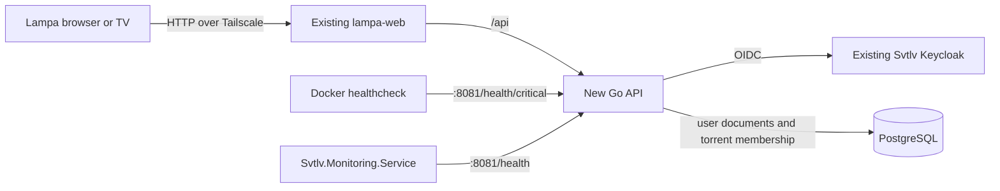

# Lampa Svtlv User Data Persistence Design

Status: Draft

Date: 2026-09-15 (authentication and Account UI decisions added 2026-09-24;
Plan 3 storage and TorrServer decisions updated 2026-10-14)

Target branch: `svtlvtv`

## 1. Decision

Add a small Go backend that stores one Lampa user-owned data document per signed-in
user. Device settings stay on each device.

The server is the source of truth for signed-in users:

1. User logs in.
2. Lampa requests the user's data from the server.
3. If server data exists, Lampa applies only its user-scoped fields to
   `localStorage` and uses them.
4. If server data does not exist, Lampa uploads the current user-scoped data.
5. Lampa reads the saved server data and applies only its user-scoped fields.
6. Later signed-in changes update `localStorage`; user-scoped changes replace
   the document on the server.

Anonymous user data stays in browser storage and no user-data request is sent
to the backend. Plan 3 separates guest My Torrents through device-local
membership and suppresses shared TorrServer timecodes (§10.4); other optional
external services keep their current behavior.

## 2. Scope

Persist durable user-owned data already saved by Lampa, including:

- portable content and account preferences;
- favorites and bookmarks;
- scores and reactions;
- subscriptions;
- watched state and playback progress;
- useful history;
- other durable personal data discovered during the ownership audit (§10.3).

Keep playback engines, hardware and device-specific network configuration,
temporary caches, current navigation state, device-detection values, temporary request data and
authentication tokens owned by another service out of the user document. The
scope of each concrete storage key is defined in §10.3 before synchronization.
TorrServer's own saved torrents and timecodes are separate from browser storage
and require the handling in §10.4.

TorrServer and Jackett remain unchanged and the browser calls them directly;
the API does not proxy their traffic. Plan 3 reduces Lampa's built-in TorrServer
settings to one URL through a small, marked `app.min.js` patch and a matching
`assembly.json` stamp. Account, ownership and synchronization integrations stay
in `svtlv/`; compiled stylesheets and upstream language files remain unchanged.
Upstream bundle updates require reapplying the one-link patch (§10.2).

## 3. Architecture



Components:

- `lampa-web` continues serving the existing static application and proxies
  `/api/v1/` to the Go service (Apache `mod_proxy_http` inside the `lampa-web`
  image, added in Plan 2).
- `lampa-api` handles login, sessions, user-data reads and writes, and
  authenticated torrent-membership operations.
- the existing Svtlv Keycloak identifies the user.
- PostgreSQL stores the complete user document in JSONB (login sessions are
  stateless cookies, §5.3).
- a small ES5 Account add-on (`svtlv/account.js`, Plan 2) adds sign-in,
  sign-out and the header avatar to Lampa through its public API (§10.5).
- an ES5 ownership add-on (`svtlv/torrserver-ownership.js`, Plan 3) wraps
  the public `Lampa.Torserver` methods before My Torrents can render (§10.4).
- a small ES5 browser adapter (Plan 4) exports data from Lampa, calls the API
  and imports server data into `localStorage`.

The frontend adapter is required because a backend cannot directly read or
update browser `localStorage`.

### 3.1 Go engineering baseline: Ralphex

Use Ralphex as the engineering baseline for the new Go module. The baseline
inspected for this design is Ralphex `master` at commit `a736d5e`; re-check its
current `master` at the start of Plan 1 so the Go version and pinned tool
versions do not drift accidentally.

Ralphex is the reference for project structure, code style and quality checks,
not for Lampa's business architecture. Do not copy Ralphex CLI, dashboard or
executor dependencies into this service unless the backend actually needs
them.

Keep the Go module additive and isolated from upstream Lampa files:

```text
backend/
├── cmd/lampa-api/       # composition root and process lifecycle
├── pkg/api/             # HTTP routes, middleware and response contract
├── pkg/auth/            # Keycloak OIDC and session handling
├── pkg/config/          # typed environment configuration and validation
├── pkg/health/          # Svtlv-compatible health reports
├── pkg/storage/         # user-data service and PostgreSQL implementation
├── migrations/          # versioned PostgreSQL schema
├── Makefile
├── go.mod
├── go.sum
└── vendor/
```

Follow these Ralphex conventions:

- use the same pinned Go toolchain in `go.mod`, CI and the Docker builder
  (`go 1.26.0` in the inspected baseline);
- use `cmd/<binary>` for the entry point and small `pkg/<responsibility>`
  packages, with private internal state and explicit constructors;
- prefer the standard library, including `net/http`, and add a dependency only
  when it directly reduces necessary implementation work;
- define narrow interfaces in the consuming package, pass `context.Context` as
  the first argument to blocking or cancellable operations, and generate mocks
  with `moq` into a `mocks/` subdirectory when a generated mock is useful;
- wrap errors with operation context and `%w`, validate constructor/configuration
  inputs, set explicit HTTP timeouts, and shut the server down through a bounded
  context;
- use a small injected logger interface where test isolation requires it and
  never log user documents or secrets;
- use lowercase comments except for exported Go documentation comments;
- commit `go.mod`, `go.sum` and `vendor/`; after dependency changes run
  `go mod tidy` and `go mod vendor`.

Configuration should use typed structs, defaults and startup validation in the
same style as Ralphex, without copying Ralphex's CLI-specific `go-flags`
configuration. The files follow Svtlv's `appsettings` layering:

- `appsettings.json` holds the shared defaults and `appsettings.<Environment>.json`
  overrides only what differs (database location and Keycloak realm). Both are embedded
  with `//go:embed` and decoded strictly into one struct, so an unknown key is an
  error;
- the environment comes from `LAMPA_ENVIRONMENT` (`Development`, `Test` or
  `Production`, default `Test`). Development is a local `go run` against the
  database published on loopback `5434`;
- secrets are `{ENV_VAR}` placeholders (`{LAMPA_DB_PASSWORD}`,
  `{LAMPA_API_DATA_KEY}`, `{LAMPA_KEYCLOAK_CLIENT_SECRET}`) resolved from the
  environment. `Authentication.Keycloak.Authority` is a checked-in setting. Missing secrets fail startup naming the variable,
  never the value. No other environment variable overrides a file setting.

Ports follow the Svtlv series without colliding with it: the API listens on
`5800` inside the Compose network and is reached only through the `lampa-web`
`/api/v1/` proxy (not published since Plan 2), health stays on the
container-internal `8081`, and PostgreSQL is published only on
`127.0.0.1:5434` (Svtlv uses `5433`, Keycloak `8080`).

The backend quality contract is:

- provide Ralphex-style `make build`, `make test`, `make lint`, `make fmt` and
  `make race` targets inside `backend/`;
- `make test` runs all packages with the race detector and a coverage profile;
- tests use the standard `testing` package plus `testify/assert` and
  `testify/require`, table-driven subtests, `httptest` for HTTP handlers,
  `t.Helper()` in helpers and `t.TempDir()` for filesystem work;
- keep one matching test file per source file (`foo.go` -> `foo_test.go`) and
  target at least 80% coverage for new backend code, excluding generated mocks;
- start from Ralphex's GolangCI-Lint v2 configuration, using the same enabled
  linters and settings, and pin the same linter version in CI (`v2.13.0` in the
  inspected baseline); copy only exclusions that apply to this service and
  explain every Lampa-specific suppression;
- CI runs the same race, coverage and lint checks before building an image;
  tool/action versions are pinned rather than floating silently;
- use a multi-stage Docker build with revision metadata and a minimal non-root
  runtime image.

The Ralphex commands and configuration are the source of truth when the plan is
implemented. If a Lampa-specific need requires a deviation, record the reason
in that implementation plan. Ralphex's automatic CI/release triggers are not
copied: Lampa production deployment remains `workflow_dispatch` only.

## 4. Data model

Use one row per Keycloak user:

```sql
create table lampa_user_data (
    user_id uuid primary key,
    schema_version integer not null,
    data jsonb not null,
    encrypted_connections bytea null,
    created_at timestamptz not null,
    updated_at timestamptz not null
);
```

`user_id` is the Keycloak `sub` UUID. The browser never chooses or sends a
different owner ID; the backend obtains it from the authenticated session.

The JSON document has a simple top-level structure:

```json
{
  "settings": {},
  "favorites": {},
  "bookmarks": {},
  "scores": {},
  "subscriptions": {},
  "progress": {},
  "history": {},
  "other": {}
}
```

The exact inner values follow the formats already used by Lampa. The backend
validates the allowed sections, document size and valid JSON, but it does not
create separate relational tables for every Lampa feature.

Plan 3 adds a separate membership table through migration
`00002_create_lampa_torrserver_hashes.sql`:

```sql
create table lampa_torrserver_hashes (
    user_id uuid not null,
    server_id text not null check (server_id ~ '^[A-Za-z0-9_-]{1,64}$'),
    hash text not null check (hash ~ '^([0-9a-f]{40}|[0-9a-f]{64})$'),
    created_at timestamptz not null default now(),
    primary key (user_id, server_id, hash)
);
```

This many-to-many index is independent of the user JSON document and of
TorrServer's torrent database. Deleting a user-data document does not delete
memberships. Claims are idempotent and preserve the original row; release deletes
only the authenticated user's row on that server. There is no row cap, foreign
key to `lampa_user_data`, automatic pruning or physical TorrServer cleanup.
The critical database health check probes both tables.

Plan 4 synchronizes the sole TorrServer URL, authentication toggle, login and
password as `user_connection` fields (§10.3). The Go service already removes
sensitive settings from JSONB and seals them into `encrypted_connections`,
returning one logical document after decryption. Other connection settings stay
local; being sealable does not by itself make a key user-scoped.

## 5. Authentication

Use the existing Svtlv Keycloak realm and its existing users. Create a separate
confidential OpenID Connect client named `svtlv-lampa`. Do not reuse the
`svtlv-web` client: users and Keycloak SSO are shared at realm level, while each
application keeps its own redirect URIs, client secret and session boundary.

Lampa initially requires only a valid authenticated user. It does not consume
Svtlv Web application roles. If Lampa-specific roles are ever needed, define
them as client roles on `svtlv-lampa`, not as dependencies on another client's
roles.

Anonymous use does not require a session.

### 5.1 Supported clients

Login is supported only where Lampa runs as the web deployment at the configured
public URL, same-origin with `/api`: a desktop or phone browser, a TV browser, or
a TV app that navigates its WebView to that address. The Android client in use,
[`lampa-app/LAMPA`](https://github.com/lampa-app/LAMPA), is such an app:
`MainActivity.onBrowserInitCompleted` calls `browser.loadUrl(LAMPA_URL)` with the
address typed into its URL dialog, so the document origin is the Lampa site and
first-party cookies apply (the app has no cookie code; WebView defaults accept
and persist them). Its saved address must equal the configured public URL.

The production deployment is reachable only inside the Tailscale network, at
`http://svtlv:8092` (bound to `100.105.140.19:8092`). WireGuard encrypts that
link, but browsers treat it as plain HTTP: a `Secure` cookie is never stored
there. So every Lampa cookie (session, login and device flow) carries `Secure`
only when the public URL is `https://`; `HttpOnly` and `SameSite=Lax` always
apply. The release Compose file binds the Lampa port to the Tailscale address;
the deploy workflow verifies that mapping before deploying.

Keycloak may likewise be reached over HTTP inside the tailnet. The configured
issuer must equal, character for character, the `iss` Keycloak puts in its
tokens: a realm with a fixed public HTTPS hostname issues `https://…` even when
it is fetched over a Tailscale address, so the issuer is taken from the
discovery document the API container actually reads (Plan 2 pre-flight). The
backend then calls the token, device and JWKS endpoints exactly as that
document advertises them, and users open its authorization and verification
URLs, so all of those must be reachable. The shared `svtlv` realm's
hostname/issuer is not changed for Lampa: other Svtlv clients depend on it. With
an HTTP issuer the phone used for the TV device login must be on the tailnet
too, since the QR code points at Keycloak's verification page.

Moving Lampa to HTTPS later (`tailscale cert` / `tailscale serve`, or a real
certificate) needs TLS set up at Apache, the new `https://…/api/v1/auth/callback`
and `https://…/` post-logout redirect registered in Keycloak, and the address
saved on every device updated. Apache must pass the browser-facing scheme to the
API; the `Secure` cookie flag then follows automatically.

Shells whose document runs from `file://` or an app origin and only load
`app.min.js` remotely (`index.html` `AndroidJS.getLampaURL()` branch, packaged
Tizen/webOS widgets) are not supported: the Account add-on hides itself when
`location.protocol` is not `http:`/`https:` (§10.5), and those shells keep
working anonymously. Supporting file/app origins would need a bearer token
stored in Lampa storage,
which every plugin can read; a stolen token returns the decrypted TorrServer,
Jackett and Prowlarr credentials (`storage.Service.Get` merges
`encrypted_connections`), so it is deferred to a separate decision with explicit
risk acceptance. Credentialed CORS and `Origin: null` are never allowed: any site
can produce a null origin from a sandboxed iframe.

### 5.2 Login flows

Both flows run in the Go backend with `github.com/coreos/go-oidc/v3` and
`golang.org/x/oauth2` (vendored); no hand-written JWT validation. The browser
never receives a readable Keycloak token: only the refresh token is kept, sealed
inside the `HttpOnly` session cookie (§5.3).

The flow is chosen in the browser with Lampa's `Platform.tv()` — the same split
CUB's own login uses (QR on TV, mobile layout otherwise). `Platform.screen('tv')`
is not used: it is also true for non-touch desktop browsers.

- **TV (`Platform.tv()` true): OAuth 2.0 Device Authorization Grant (RFC 8628).**
  1. `POST /api/v1/auth/device/start` — the backend calls Keycloak's device
     endpoint and returns `user_code`, `verification_uri`,
     `verification_uri_complete`, `expires_in` and `interval`. The backend sends
     an S256 PKCE challenge. The secret `device_code` and PKCE verifier are sealed
     into a short-lived `HttpOnly` cookie scoped to `/api/v1/auth/device`; neither
     reaches the browser in plaintext.
  2. The TV shows a QR code of `verification_uri_complete` and the `user_code`
     (layout of CUB's `account-modal-split` window, without its keypad) with a
     pending status and the expiry countdown.
  3. The user scans the code and signs in to Keycloak on a phone.
  4. The TV calls `POST /api/v1/auth/device/poll` every `interval` seconds. The
     backend exchanges the sealed `device_code` with its PKCE verifier at Keycloak's
     token endpoint:
     `authorization_pending` → `202 {"status":"pending"}`; `slow_down` → `202`
     with a larger interval; `expired_token` → `410`; `access_denied` → `403`;
     success → the ID token is verified, the session is created and the response
     sets the session cookie.
- **Phone and computer: Authorization Code flow with PKCE (S256), state and
  nonce.** `GET /api/v1/auth/login?return=<path>` redirects to Keycloak;
  state, nonce, PKCE verifier and the return path travel in a sealed,
  `HttpOnly`, 10-minute cookie scoped to `/api/v1/auth/callback`.
  `GET /api/v1/auth/callback` verifies them and the ID token, creates the
  session and redirects to the return path, which must be a local absolute path
  (no scheme, host or `//`).

Cookie sealing keys are derived from `LAMPA_API_DATA_KEY` with HKDF-SHA256 and a
distinct purpose label per use, so no new secret is needed and the data-at-rest
key is never used directly for cookies.

### 5.3 Sessions

Sessions are stateless: the whole session lives in one sealed cookie and the
server keeps no session state (decided 2026-09-26; no table, no purge job).
Every authenticated request is revalidated against Keycloak, so ending the
Keycloak session, disabling or deleting the user signs them out of Lampa on
their next request (decided 2026-09-27; §5.3.1).

- the `lampa_session` cookie is AES-256-GCM sealed JSON
  `{sub, name, email, picture, created_at, idle_expires_at, refresh_token,
  refreshed_at, refresh_expires_at}`; the key is derived
  from `LAMPA_API_DATA_KEY` with HKDF-SHA256 and the purpose label
  `lampa-session-v1`, so the browser can neither read nor forge it;
- `HttpOnly`, `SameSite=Lax`, `Path=/api`, `Secure` only when the public URL
  is HTTPS (§5.1), with
  a real `Max-Age`. A session-only cookie could vanish on an app restart;
- lifetime is the app's own: sliding 30-day idle timeout, 180-day absolute
  cap. Re-login with a remote is costly, so TV sessions must last. Keycloak can
  only end a session earlier (§5.3.1), never extend it;
- the idle timeout slides only when the cookie is re-issued: `GET
  /api/v1/session` first rejects a cookie past `idle_expires_at` or past
  `created_at + 180 days`, then re-issues it with `created_at` preserved and
  `idle_expires_at = min(now + 30 days, created_at + 180 days)`, `Max-Age`
  matching. The add-on calls it at start and every 12 hours, so a TV left
  running keeps its session; other API requests validate and revalidate
  (§5.3.1) but re-issue the cookie only after a Keycloak refresh;
- after the ID token is verified the backend keeps only `sub`, `name`
  (falling back to `preferred_username`), `email` and the optional `picture`,
  all inside the cookie, plus the refresh token from the same token response.
  The access and ID tokens are discarded. The final `name=value` stays within
  4000 bytes after JSON escaping, sealing and base64 (browsers cap one cookie at
  4096; the whole serialized `Set-Cookie` value, attributes included, is
  bounded on issue and on every re-issue); an over-long `picture` URL is
  dropped, never truncated, names are length-limited, and the refresh token is
  never dropped or truncated: if it still does not fit, the login fails and is
  logged (after a refresh, the existing session is kept);
- `POST /api/v1/auth/logout` clears the session and in-progress login cookies on
  this device. On a TV it ends only the local session. A browser uses `?sso=1`
  to end the associated Keycloak session through the refresh token and then
  follows Keycloak's end-session URL to clear the browser SSO cookie. This signs
  out Svtlv apps sharing that browser session, while other browsers keep their
  sessions. A TV approved from that browser may share the same Keycloak user
  session and be signed out too. It also sets a
  `lampa_logout` cookie holding the logout time (`Path=/api`, `Max-Age` = the
  absolute timeout, unsealed: it only affects the sender's own sessions), and a
  session created up to that time is refused, so a request of another tab still
  in flight cannot sign the device back in with a renewed cookie; the next login
  deletes it;
- accepted costs of stateless sessions: a copied TV cookie stays valid after
  local logout until its Keycloak session ends or the cookie expires; revocation is
  done in Keycloak, and ending one Keycloak session revokes every app session
  tied to it (browser logins on one device can share one SSO session); the
  profile (including the avatar) refreshes on the next login. Revoking every session at once is a code
  change that bumps the purpose label (`lampa-session-v2`) — never a rotation of
  `LAMPA_API_DATA_KEY`, which also seals user data at rest;
- sessions, `GET /api/v1/session` and local logout work with the database down;
  they keep working with Keycloak down too (§5.3.1). Browser SSO logout needs Keycloak;
- the `Authenticator` seam (`api.Authenticator`) is implemented in `pkg/auth`:
  it opens the cookie, checks both expiries, revalidates (§5.3.1) and returns
  `sub`. A missing, tampered, expired or revoked cookie is
  `ErrUnauthenticated` (a revoked one is also cleared); the `authenticate`
  middleware answers `401` for it and `503 session_unavailable` for any other
  error, so a client is never told it is signed out because a dependency failed.

### 5.3.1 Revalidation against Keycloak

Decided 2026-09-27: ending a user's Keycloak session (admin console "Sign
out", or the session expiring), disabling or deleting the user signs them out
of Lampa on their **next** authenticated request (`/api/v1/session` or any
user-data call), while the 30/180-day lifetimes above stay the app's.

- every authenticated request makes one revalidation call to Keycloak with the
  sealed refresh token (the first use after a restart may add a discovery
  call), using the client credentials, an overall 3-second timeout and
  redirects disabled. No success is cached: a cache would delay revocation;
- established libraries do the protocol work (decided 2026-09-27): the refresh
  grant goes through `golang.org/x/oauth2`, the same library the login flows
  use. It does not expose token introspection, and the
  `github.com/zitadel/oidc/v3` helper omits `token_type_hint` (without it
  Keycloak treats the token as an access token), so introspection is one small
  `net/http` request. What stays ours is
  the policy: when to call, and that only an explicit "no" signs out;
- **refresh is due** when `now >= refreshed_at + min(1 day, (refresh_expires_at
  - refreshed_at) / 2)`. Then the call is a `refresh_token` grant, which also
  validates, slides Keycloak's SSO idle timer and returns a new refresh token;
  the cookie is re-issued with it (`created_at` preserved, `idle_expires_at`
  slid only by `/session`). Otherwise the call is token introspection
  (`token_type_hint=refresh_token`, endpoint from discovery), which neither
  slides the SSO idle timer nor consumes a token reuse. Keycloak 26.5.7 `RefreshTokenIntrospectionProvider` checks
  the user session and that the user exists and is enabled;
- **outcomes**: introspection `200` with `active: false`, or refresh `400
  invalid_grant` → signed out (cookie cleared, `401`, or anonymous `/session`).
  Introspection `200` with `active: true`, or refresh `200` carrying a
  non-empty refresh token and a positive `refresh_expires_in` → valid.
  Anything else (timeout, network error, another status, a malformed or
  incomplete body, an `active` that is not a JSON boolean, `invalid_client`)
  is a Keycloak failure: the session **keeps
  working** (user decision) and a `[WARN]` is logged. A Keycloak outage
  therefore breaks new logins only, and a user disabled during an outage keeps
  access until Keycloak answers again. During an outage each request waits up
  to the timeout;
- the `refresh_token` grant can run concurrently for one cookie (tabs, parallel
  requests). That is harmless only with the realm's **Revoke Refresh Token
  off**, which is therefore a deployment prerequisite, not an assumed default;
- Keycloak prerequisites (Post-Completion): realm SSO Session Idle ≥ 31 days
  (one day of slack over the app's 30, since Keycloak's idle timer slides only
  on a refresh) and SSO Session Max ≥ 180 days; client session idle/max unset
  or no shorter; Revoke Refresh Token off; `offline_access` never requested (an
  offline token outlives the SSO session, defeating revocation). The 30/180
  days are caps, not guarantees: a phone's SSO session may have started before
  the Lampa login, so Keycloak's max can end it earlier;
- cookies issued before this change have no refresh token and are rejected
  (one re-login).

### 5.4 Avatar

The avatar follows Svtlv: Keycloak's `profile` scope omits `picture` unless a
client mapper adds it, so its absence is the normal case. With a `picture`
user-attribute mapper on `svtlv-lampa`, the URL comes from the ID token; without
it the add-on draws the user's initials.

### 5.5 CSRF

Every state-changing route (`POST`, `PUT`, `DELETE` — logout, device start/poll,
user data and torrent membership) requires the header `X-Lampa-Csrf: 1`. Any XHR
can set it (including jQuery on Safari 5.1-era TV engines); a cross-site form cannot, and a cross-origin
script would need a CORS preflight the API never grants. In addition a request
whose `Origin` header is present and differs from the request's scheme and Host is
rejected. A missing `Origin` or `Sec-Fetch-Site` alone never rejects a request,
because old TV engines send neither. Plugins run same-origin and can set the
header; CSRF protection cannot isolate them, and SECURITY.md already treats
plugins as untrusted code.

### 5.6 Keycloak client

`svtlv-lampa` in the `svtlv` realm: confidential client, Standard flow on,
"OAuth 2.0 Device Authorization Grant" on, direct access grants off, valid
redirect URI `<origin>/api/v1/auth/callback` and post-logout redirect URI
`<origin>/` for every browser-facing host (exact Keycloak registrations), no web origins
(the browser never calls Keycloak with CORS). Optional: a `picture`
user-attribute mapper (§5.4). The backend is configured with the realm issuer
URL, the client ID and the client secret (`{LAMPA_KEYCLOAK_CLIENT_SECRET}`).

## 6. Synchronization behavior

### 6.1 Anonymous startup

1. Lampa starts normally.
2. It reads and writes its current browser storage.
3. The sync adapter does not call the user-data API.

Result: user-document storage remains local. Guest My Torrents follows the
device-local membership policy in §10.4.

### 6.2 Login when server data exists

1. Complete Keycloak login.
2. Call `GET /api/v1/user-data`.
3. Receive the complete server document.
4. Replace only the user-scoped Lampa values in `localStorage` with that document.
5. Refresh or restart the affected Lampa components.

The previous local user values do not overwrite existing server data. The
server document wins for user-scoped fields; device settings stay local.

### 6.3 Login when server data does not exist

1. Complete Keycloak login.
2. Call `GET /api/v1/user-data`.
3. Receive `404 Not Found` with error code `user_data_not_found`.
4. Export the current user-scoped durable Lampa values from browser storage.
5. Call `PUT /api/v1/user-data` with the complete document.
6. Call `GET /api/v1/user-data` again.
7. Apply only its user-scoped values to `localStorage`.

This is the only automatic import of pre-login local data. Existing server data
is never silently replaced during login.

### 6.4 Changes while signed in

1. Lampa writes the change to `localStorage` as it does today.
2. If its key is user-scoped, the adapter waits for a short debounce period.
3. The adapter exports the complete durable document.
4. It calls `PUT /api/v1/user-data`.
5. A successful response means the server has accepted the new source-of-truth
   document.

Multiple changes during the debounce period produce one server write.

### 6.5 Later startup or refresh

When an authenticated session exists, Lampa gets the server document before
normal synchronized data is used. Server values replace only the synchronized
user-scoped local values.

If the server is temporarily unavailable, Lampa continues with its current
local data and displays a small synchronization error. It must not clear local
storage because of a network error.

## 7. Conflict policy

The first version deliberately uses a simple policy:

- the server stores one complete document;
- each successful `PUT` replaces the previous document;
- the last successful save wins;
- login and startup always prefer the server document;
- there is no field-level merge, change cursor, mutation log or tombstone table.

This means two devices editing at the same time can overwrite each other's last
changes. That is an accepted first-version limitation. More complex merging
should be added only if real usage demonstrates the need.

## 8. API

| Method and path | Purpose |
| --- | --- |
| `GET /api/v1/auth/login` | Start the Authorization Code login (phone, computer) |
| `GET /api/v1/auth/callback` | Finish that login and create the session |
| `POST /api/v1/auth/device/start` | Start the device login (TV); returns the user code and verification links |
| `POST /api/v1/auth/device/poll` | Poll the device login; creates the session when approved |
| `POST /api/v1/auth/logout` | End session |
| `GET /api/v1/session` | Return login status and the signed-in profile |
| `GET /api/v1/user-data` | Return the signed-in user's complete document |
| `PUT /api/v1/user-data` | Create or replace the complete document |
| `DELETE /api/v1/user-data` | Delete the signed-in user's cloud document |
| `GET /api/v1/torrservers/{server_id}/hashes` | `200 {"hashes":[...]}`, sorted; an empty array when this user has no claims |
| `PUT /api/v1/torrservers/{server_id}/hashes/{hash}` | `204`, idempotently claim a successfully added torrent; no body required |
| `DELETE /api/v1/torrservers/{server_id}/hashes/{hash}` | `204`, idempotently remove only this user's claim, never the TorrServer record |
| `GET :8081/health` | Return all critical and advisory health checks |
| `GET :8081/health/critical` | Return only Docker-critical health checks |

Example successful response:

```json
{
  "schema_version": 1,
  "data": {
    "settings": {},
    "favorites": {},
    "bookmarks": {},
    "scores": {},
    "subscriptions": {},
    "progress": {},
    "history": {},
    "other": {}
  },
  "updated_at": "2026-09-15T12:00:00Z"
}
```

`GET /api/v1/session` always answers `200`, anonymous or signed in, so an
anonymous start logs no error; a missing, tampered or expired cookie is simply
anonymous (sessions are stateless, §5.3):

```json
{ "authenticated": false }
```

```json
{
  "authenticated": true,
  "user": {
    "id": "4f1c…",
    "name": "User Name",
    "email": "user@example.com",
    "picture": ""
  }
}
```

The API requires authentication for every user-data and torrent-membership
operation, limits request size and never accepts a `user_id` from the request
body or URL. Membership operations must be idempotent. State-changing routes
require `X-Lampa-Csrf: 1` (§5.5).

The ownership add-on sends `X-Lampa-Expected-User` with its captured user ID
on every membership request. This optional precondition never establishes
identity: a mismatch with the cookie-authenticated user returns
`409 account_changed` before accessing storage. The add-on fails closed,
rechecks the session, and never retries the operation under a new identity.
Inactive My Torrents components are discarded on account, URL or guest-storage
changes so returning from a detail screen rebuilds the filtered list.

Membership routes accept a `server_id` of 1–64 ASCII letters, digits,
underscores or hyphens. The add-on sends the SHA-256 ID described in §10.4;
the backend receives no TorrServer URL. Hashes are trimmed and lowercased,
then must contain 40 or 64 hexadecimal characters. Invalid parameters return
`400 invalid_server_id` or `400 invalid_hash`; authentication failures return
`401 unauthenticated` or `503 session_unavailable`, and storage failures return
`503 storage_unavailable`. PUT and DELETE also enforce CSRF. Access and panic
logs redact all paths starting `/api/v1/torrservers/` to
`/api/v1/torrservers/…`, including error paths, so neither server IDs nor hashes
are logged there. Access logs omit bodies, headers, cookies and query strings.

## 9. Health and Svtlv monitoring

The Go service must reproduce the existing Svtlv two-tier health contract even
though it cannot reference the .NET `Svtlv.Common.HealthChecks` library.

Both endpoints listen on container-internal HTTP port `8081` and are not
published to the host or proxied through the public Lampa origin. Their consumers
are intentionally separate: Docker Compose calls only `/health/critical`, while
`Svtlv.Monitoring.Service` calls only `/health`.

### 9.1 Endpoints

- `/health` runs every critical and advisory check. `Svtlv.Monitoring.Service`
  consumes this endpoint; operators may also use it for diagnosis.
- `/health/critical` runs only critical checks. It is used exclusively by the
  Docker Compose healthcheck.
- health endpoints require no user login because they are private network
  endpoints.

Initial checks:

| Check | Tier | Meaning |
| --- | --- | --- |
| `database` | Critical | PostgreSQL is reachable and the required schema is usable |
| `keycloak` | Advisory | Keycloak discovery/login dependency is reachable |

A database failure makes persistence unusable and returns `Unhealthy` from both
endpoints. A Keycloak failure prevents new logins but does not invalidate
existing sessions or justify restarting the API, so `/health` becomes
`Degraded` while `/health/critical` remains `Healthy`.

Plan 1 ships only the `database` check; `keycloak` is added in Plan 2 (see the
Plan 1 deviations in §14).

### 9.2 JSON contract

Both endpoints return the same camel-case document shape used by Svtlv:

```json
{
  "status": "Healthy",
  "totalDurationMs": 1.234,
  "checks": [
    {
      "name": "database",
      "status": "Healthy",
      "description": "PostgreSQL is reachable.",
      "durationMs": 1.123,
      "error": null
    }
  ]
}
```

Allowed status strings are `Healthy`, `Degraded` and `Unhealthy`. HTTP status
mapping must also match Svtlv:

- `Healthy` -> `200`;
- `Degraded` -> `200`;
- `Unhealthy` -> `503`.

The JSON document and each check's `status` are authoritative. A `200` response
does not prove health because advisory failures deliberately return
`Degraded` with HTTP `200`.

Descriptions and errors must be short and must never contain connection
strings, credentials, user data or Keycloak tokens.

### 9.3 Docker healthcheck

The `lampa-api` container uses the critical endpoint:

```yaml
healthcheck:
  test: ["CMD-SHELL", "curl -fsS http://localhost:8081/health/critical || exit 1"]
  interval: 30s
  timeout: 10s
  retries: 5
  start_period: 30s
```

### 9.4 Svtlv.Monitoring.Service target

The Lampa deployment and Monitoring service must share a private Docker network
or another private route on which `lampa-api:8081` is resolvable. Add this target
to the Svtlv monitoring configuration when the API is deployed:

```json
{
  "Id": "lampa-api",
  "Name": "Lampa API",
  "Kind": "Url",
  "Enabled": true,
  "Severity": "Critical",
  "Interval": "00:01:00",
  "Timeout": "00:00:05",
  "Url": {
    "Url": "http://lampa-api:8081/health",
    "Evaluator": "HealthReport",
    "StatusPolicy": "Reachable",
    "TreatDegradedAs": "Alert"
  }
}
```

Monitoring must call `/health`, not `/health/critical`, so it can notify about
both `Unhealthy` critical checks and `Degraded` advisory checks. Docker remains
the independent consumer of `/health/critical`.

## 10. Browser integration and upstream compatibility

Keep account, ownership and synchronization integrations outside the generated
Lampa files. The agreed one-link core patch is the narrow exception:

```text
svtlv/
├── account.js                # Plan 2, sign-in, sign-out, header avatar
├── account.css               # Plan 2
├── torrserver-ownership.js   # Plan 3, account and guest membership views
├── storage-scope.json        # Plan 3, classified storage allowlist for Plan 4
├── account-sync.js           # Plan 4, user document sync
└── account-sync.css
```

Add only clearly marked script and stylesheet includes to `index.html`.
`app.min.js` is loaded asynchronously and may come from the local distribution
or an Android-provided remote URL, so every add-on must wait until the
public `window.Lampa` API is available before initializing.

The adapter must use ES5 syntax and public Lampa/jQuery APIs because the
application supports older TV browsers. In particular, observe changes through
`Lampa.Storage.listener.follow('change', ...)`; do not replace `localStorage`,
patch `Lampa.Storage.set`, or depend on generated internal names with `$N`
suffixes.

The synchronization adapter has four small responsibilities:

1. `exportData()` reads only the approved user-scoped durable values.
2. `importData(data)` writes only those values into the correct local stores.
3. `loadFromServer()` implements the login/startup flow.
4. `saveToServer()` debounces and uploads the complete document.

Do not replace the global `localStorage` object or send every storage key
blindly. Export/import code must use an explicit key allowlist, preserving
device-local values on login, account change, refresh and logout. Unknown keys
stay local until classified; newly added upstream settings do not automatically
become user data.

### 10.1 Hard compatibility rules

- Do not edit `app.min.js` for account, login or synchronization behavior.
- Do not edit compiled `css/app.css`; use the add-on stylesheets in `svtlv/`.
- Do not modify upstream language bundles for the first version; keep the small
  Svtlv UI text inside the add-on until upstream-safe localization is designed.
- Use only stable names exported through `window.Lampa`.
- Treat add-ons as optional for Lampa startup: script failure must not prevent
  boot. While the ownership add-on is active, unresolved identity or membership
  failure must fail closed for My Torrents; never expose the shared list. A
  missing or disabled ownership add-on leaves upstream list/removal behavior
  available, which deployment checks must detect.
- Keep backend, database, deployment and documentation files in additive
  directories that upstream Lampa does not own.
- The marked one-link `app.min.js` patch and matching `assembly.json` stamp are
  the explicit Plan 3 core-change decision. Any further generated-file change
  requires a separate decision.

### 10.2 Minimal loader seam

The loader seam is the marked `svtlv:begin/end` block in `index.html`, first
added in Plan 2. Plan 3 loads the ownership script before starting the original
local/remote bundle loader, with a missing-file fallback that still starts
Lampa. The ownership script waits for and wraps the public `window.Lampa` API
before it is published, protecting the first My Torrents render, including a
saved start page or deep link. Initialization errors never interrupt boot.

This works for both current loader branches:

- local `app.min.js`;
- an Android-provided remote `app.min.js` with local fallback.

When frontend updates are received, preserve the marked `index.html` loader
seam and reapply the small, marked one-link bundle patch with its version and
`assembly.json` stamp. Run the bundle drift/runtime guards, ES5 checks and Lampa
smoke checks. Account, ownership and sync integrations remain in `svtlv/`.

### 10.3 Storage ownership audit (Plan 3)

`svtlv/storage-scope.json` is the machine-readable inventory of the shipped
bundle, audited at its read/write sites. Version 1 defines six scopes; the table
below summarizes their actual rules. The JSON file is the complete authority.

| Scope | Examples and rule |
| --- | --- |
| `user` | `favorite`, `file_view`, `file_view_*`, `language`, `mine_reactions`, `online_last_balanser`, `online_view`, `online_watched_last`, `person_subscribes_id`, `search_history`, `tmdb_lang`, `torrents_view`, `user_clarifys`. Portable preferences and durable user data; bounded cache access does not change ownership. |
| `user_connection` | `torrserver_url`, `torrserver_auth`, `torrserver_login`, `torrserver_password`. Only the sole TorrServer endpoint, authentication toggle and credentials are portable connection fields. Login/password are sealed by the API. |
| `device` | `player`, `player_iptv`, `player_torrent`, `player_volume`, `interface_size`, `navigation_type`, `plugins`, `plugins_blacklist`, `menu_sort`, `menu_hide`, `start_page`, `content_rows*`, `parental_control_pin`, `torrserver_url_two`, `torrserver_use_link`, `svtlv_torrserver_legacy_links`. Hardware, controls, executable plugins, feature-dependent menus and legacy migration/rollback state never sync. |
| `connection` | `jackett_url`, `jackett_key`, `prowlarr_url`, `prowlarr_key`, `parser_use`, `parser_use_link`, `parse_lang`, `tmdb_proxy`, `proxy_other`, `cub_domain`, `torrserver_savedb`, `torrserver_tracktimecode`. Other endpoints, credentials and server/device-dependent behavior stay local. |
| `external` | `account`, `account_bookmarks_*`, `account_timeline_sync*`, `account_plugins`, `cloud_token`, `cloud_use`, `terminal_access`. CUB and third-party identity, tokens, cursors and service-owned data never become Keycloak user data. |
| `cache` | `activity`, `torrents_filter_data`, `recomends_list`, `recomends_scan`, `timetable`, `cub_alive`, `lampa_uid`, `region`, `storage_*`. Generated navigation, cached responses, device identity and sync bookkeeping stay local. |

Plan 4 exports only `user` and `user_connection` rules. Exact keys take precedence
over prefixes; the longest trailing-asterisk prefix wins. Duplicate or stale
rules are rejected. Unclassified keys, including arbitrary plugin/add-on values,
remain device-local; they are never implicitly allowed for export.

For the four `user_connection` fields, Plan 4 uploads device connection values on
first login only when the server has none. Once the server has connection values,
those win until the user explicitly edits them. Legacy secondary URL, selector
and rollback journal are never uploaded. Until Plan 4 implements synchronization,
devices with different sole URLs see different torrent membership sets.

`language` and `tmdb_lang` were verified as portable interface/content
preferences. `plugins`, `plugins_blacklist`, `menu_sort`, `menu_hide` and
`start_page` remain device-local because scripts and features can differ.
`torrserver_savedb` controls saved playback additions and is connection-local,
rather than a portable account preference. `file_view_*` carries the active CUB
profile suffix: Plan 4 must map only that active profile and never import another
CUB account's progress. Preserve excluded device values on every import.

`TestStorageScope_matchBundle` shares `readBundle(t)` with
`TestSensitiveSettings_matchUI`. It extracts literal Storage methods, direct
local/session storage access, Params registrations, settings template names and
concatenated key fragments. New unclassified bundle keys, missing/invalid scope
data and stale rules fail CI; only a backend-only checkout without the bundle
skips the guard. Variable-built keys are audited manually and guarded through
their literal bases. The JSON `notes` records those limits and ambiguous choices.

CUB also writes `online_view`, `torrents_view`, `search_history`,
`online_last_balanser` and `user_clarifys` through `Storage.sync`;
`torrents_filter_data` remains cache despite its CUB writer. CUB bookmark,
progress, reaction and subscription writers, plus its manual whole-storage
backup/restore, can overlap with local user state. Plan 4 must coordinate those
writers and the active CUB profile rather than blindly replacing their values.

### 10.4 TorrServer data ownership (Plan 3)

The browser continues calling the configured TorrServer directly for list, add
and playback. `lampa-api` never contacts TorrServer and never receives a URL
through membership requests. `svtlv/torrserver-ownership.js` wraps the public
`Lampa.Torserver` methods to filter My Torrents before rendering, record canonical
returned hashes, and replace removal with membership release.

**One URL and server identity.** The built-in settings now expose only
`torrserver_url`; there is no secondary input or link selector. Before normal
startup reads settings, a one-time migration preserves the previously effective
URL: selected primary or secondary, falling back to the other only if the
selected field was empty. It first stores original URLs and selection in
`svtlv_torrserver_legacy_links`, a device-local rollback journal and completion
marker. Both empty stays unconfigured. Persistence failure is reported; later
edits or clearing the sole URL never restore a legacy link. Normal torrent,
parser/search, authentication, status and speed-test paths use only that field.
Explicit request schemes retain the existing `Utils.checkEmptyUrl` behavior.

The add-on trims and lowercases the sole URL, removes its HTTP(S) scheme and
trailing slashes, then synchronously computes an ES5 SHA-256 digest (64 lowercase
hex characters). This `server_id` does not depend on the page's scheme or a
short 32-bit hash. Different host aliases, paths or ports identify different
membership sets; changing the URL hides old rows and restoring it reveals them.
Plan 4 converges devices on the account's sole URL and credentials (§10.3).

| Operation | Signed-in account | Anonymous guest |
| --- | --- | --- |
| List | Intersect the live TorrServer list with this user's database hashes for the server | Intersect it with this browser profile's local hashes for the server |
| Explicit Add | Original direct add, then claim the canonical returned hash | Original direct add, then record the canonical hash locally |
| Internal playback-add | Record the returned hash only if `torrserver_savedb` was enabled at invocation | Same rule, with local recording |
| Remove | Delete only this user's database row | Delete only this browser's local membership |
| Physical deletion | Operator action outside this integration; never send `action: rem` | Same |

Account membership is `(user_id, server_id, hash)`. The backend obtains the user
only from the authenticated session. A hash can belong to several users; release
by A preserves B's row and the TorrServer record, including when A was the last
owner. There is no automatic cleanup or row pruning. Shared `/viewed` reads and
writes are suppressed in both modes, including unresolved identity; Lampa's own
local `file_view*` progress continues working.

Guests keep a versioned map in plain
`localStorage['svtlv_torrserver_guest_hashes']`, partitioned by server ID, outside
Lampa.Storage and the Plan 4 allowlist. Separate browser profiles have independent
lists; people sharing one profile share its guest list. Clearing storage loses
membership, never torrents. Login/logout never copies hashes between guest and
account storage. Existing unowned TorrServer records stay hidden for everyone
until each account or guest re-adds them; there is no automatic import or claim UI.

**Session readiness and failures.** `account.js` publishes `checking`,
`signed_in`, `guest` or `unavailable` with a generation counter. Initial unknown
identity never guesses guest mode. Lists fail closed with an empty state and a
notification when identity is unresolved, the ownership API fails, or guest
storage is corrupt/unavailable. A successful anonymous session response or
logout confirms guest mode. A previously confirmed guest remains a guest during
a later refresh outage; a previously signed-in or unknown state cannot become
a guest from an outage. An ownership `401` fails the current call, immediately
marks state checking and triggers a session recheck. Calls capture identity,
server and generation; stale responses are ignored, and account operations never
switch into guest storage on a `401` or mode change. Session resolution refreshes
an active My Torrents screen.

Signed-in list lookup and the original TorrServer request start together, keeping
upstream request-queue timing intact; guest membership is validated before its
list request. Nothing renders until membership and the live list settle. Explicit
Add waits for membership persistence before reporting success; failed or missing
canonical hashes notify rather than claim success. Playback success does not wait
for membership persistence and can continue with a notification on recording
failure. Failed removal notifies and refreshes the still-active originating list
because a timed-out account release may have committed. Physical removal is never
a fallback. A TorrServer add failure creates no membership.

On Android with `internal_torrclient` disabled, the external client uses
`Android.openTorrent` / `Android.playHash`, bypassing `Lampa.Torserver.hash`.
Only explicit Add to My Torrents records membership there. Internal playback
with `torrserver_savedb` disabled is transient and creates no dormant claim.

Manual TorrServer deletion leaves account rows and guest entries intact. The
intersection hides the absent torrent; re-adding the same canonical hash restores
visibility for every retained membership, even if another client performs the
re-add. A membership already removed through Lampa stays hidden. A different
canonical hash requires a new claim. Do not infer deletion or prune rows from
one empty/failed list response; the public client cannot distinguish those cases.

This is **application view separation**, not TorrServer access control. Anyone
with the URL or credentials can still list or delete records directly. A missing
or disabled ownership script permits upstream shared-list and physical-removal
behavior while Lampa still boots. Deployment must verify the script loads and
filters the first render on supported browser and TV clients. Strong isolation
would require separate TorrServer instances or an authenticated proxy that also
blocks direct access, outside this plan.

### 10.5 Account add-on (Plan 2)

`svtlv/account.js` is identity-only: it calls `GET /api/v1/session`, the login
and logout routes, and never the user-data API. The UI copies Lampa's existing
CUB account screens (same classes, focus styling and remote navigation) and is
named just **Account**. A mockup of every screen is kept at
https://claude.ai/artifact/YCNYMgMfV3qbFPZjLPgv5A.

**Settings entry.** `Lampa.SettingsApi.addComponent({component: 'account_lampa',
name: 'Account', before: 'interface', ...})`. The anchor is `interface`, not
`account`: when `lampa_settings.account_use` is false Lampa removes the CUB
`account` folder, and an insert relative to a missing anchor silently drops
the entry. Inside, it mirrors CUB's account template: a short description,
then either "Sign in" or "Signed in as <email>" and "Log out".

**Header icon.** The add-on puts its own `head__action selector` icon in the
slot CUB's profile icon uses (before `.full--screen`) and hides CUB's
`.open--profile` with one CSS rule. It is the same place and look for the
user; a separate element is needed because CUB's `Profile.init` does not run
when `account_use` is false, and CUB's `Profile.update()` empties its own icon
asynchronously after profile checks. The icon shows, in order: the Account
avatar (`picture`, else initials), CUB's profile image
(`Lampa.Account.Profile.icon()`) when only CUB is signed in, else the plain
profile icon. Pressing it opens a `Lampa.Select` menu:

- nobody signed in: "Sign in" with two choices, **Account** or **CUB**
  (`Lampa.Account.Modal.account()`);
- Account signed in: the profile row (avatar, name, email), "Switch CUB
  profile" (`Lampa.Account.Profile.select()`) or "Sign in to CUB",
  "Account settings" and "Log out";
- only CUB signed in: CUB's own profile list, plus "Sign in to Account".

CUB and Account are independent: both can be signed in at once and signing out
of one never touches the other. The add-on reads CUB state only through
`Lampa.Account.Permit` and never writes `account*` storage keys.

**Sign-in.** On `Lampa.Platform.tv()` the device flow modal (§5.2) opens with
`Lampa.Modal` size `full`; elsewhere the browser navigates to
`/api/v1/auth/login?return=<current path>`. On success a `Lampa.Noty`
"Signed in as <email>" appears and the icon and settings refresh.

**Sign-out.** A `Lampa.Select` confirmation, then `POST /api/v1/auth/logout`
with `X-Lampa-Csrf: 1`. Browser callers add `?sso=1` and navigate to the
returned Keycloak logout URL; TV callers clear only their local session.

Strings (en and ru) live inside the add-on (§10.1). The add-on hides
everything and leaves CUB's icon visible when `location.protocol` is not
`http:`/`https:` or when `/api/v1/session` is unreachable.

## 11. Failure behavior

- No server document: upload current user-scoped local data, read it back and use it.
- API unavailable during login: keep current local data and show sync as
  unavailable; do not initialize the server document.
- API unavailable during save: keep the local change and show that it has not
  been saved to the server. A later save may retry the complete current
  document.
- PostgreSQL unavailable: both health endpoints report `Unhealthy`, the Docker
  critical probe fails and user-data endpoints return a temporary error.
- Keycloak unavailable: existing sessions (revalidation fails open, §5.3.1),
  anonymous mode and already-loaded local data continue working; new login
  fails cleanly and `/health` reports `Degraded`.
- Invalid server document: reject it and keep the current local values.

## 12. Security

- Serve login and API traffic through HTTPS, or through HTTP only inside the
  Tailscale network with the Lampa port bound to the Tailscale address (§5.1);
  the same holds for Keycloak, whose configured issuer must equal its `iss`.
- Use sealed, stateless session cookies (`HttpOnly`, `SameSite=Lax`, `Secure`
  when the public URL is HTTPS) that the browser can neither read nor forge (§5.3).
- Keep Keycloak access and ID tokens out of the browser; keep the refresh token
  only sealed inside the `HttpOnly` session cookie; keep all of them out of the
  database and logs.
- Revalidate every authenticated request against Keycloak (§5.3.1), so a
  session ended, or a user disabled or deleted, in Keycloak is signed out on the
  next request.
- Protect modifying requests against CSRF with `X-Lampa-Csrf` plus the
  `Origin` check (§5.5); never enable credentialed CORS or trust
  `Origin: null`.
- Accept only local absolute paths as login return targets (no open redirect).
- Derive ownership only from the authenticated Keycloak session.
- Seal the synchronized TorrServer login/password before database storage;
  keep all other device-local connection credentials out of user-data exports.
- Never log user documents, connection values, credentials or Keycloak tokens.
- Limit JSON nesting, section sizes and total request size.
- Keep the API and PostgreSQL ports private.
- Keep port `8081` and detailed health responses private to Docker and the
  monitoring network.

## 13. Existing deployment

The existing Lampa, TorrServer and Jackett services are the working baseline.
They are not recreated or reconfigured by this project.

Deployment work only adds:

- the `lampa-api` image;
- PostgreSQL database access for that API;
- the Apache `/api` reverse proxy;
- backend secrets and migration execution;
- the Svtlv-compatible health endpoints and Docker critical healthcheck;
- private network reachability from `Svtlv.Monitoring.Service`;
- Ralphex-style Go build, race-test, coverage and lint gates in a `tests.yaml`
  workflow next to the existing manual CI/CD workflow.

Disabling document synchronization leaves user data local. An active ownership
add-on still applies guest membership and fails closed when account lookup is
unavailable; disabling that add-on restores upstream shared-list behavior.

## 14. Roadmap

Each step is one separate implementation plan. Complete and verify the plans in
this order. There is no final standalone CI/CD or deployment plan: every plan
must include the tests, image, Docker Compose, manual CI/CD, deployment,
healthcheck, smoke verification and rollback changes required by its feature.
The deployment workflow remains manual-only and remote server commands continue
to use `docker-compose`.

### Plan 1: Build and deploy the Go persistence service

Re-check the current Ralphex baseline and create the isolated `backend/` Go
module with its package layout, Make targets, vendoring, GolangCI-Lint v2
configuration and test conventions. Create the Go API and its PostgreSQL table
containing one JSONB document per user. Implement user-data read, replace and
delete operations, sensitive-value encryption, validation, table-driven tests,
and the Svtlv-compatible `/health` and `/health/critical` endpoints. In the same
plan, create the multi-stage backend image, add the API and database connection
to Docker Compose, run the Ralphex-style race/coverage/lint gates before image
build in the manual CI/CD workflow, add the Docker `/health/critical` probe,
register `/health` in `Svtlv.Monitoring.Service`, deploy it and verify rollback.

Result: the backend is running and monitored on the server and can securely
store and retrieve isolated user documents.

Deviations recorded while implementing Plan 1
(`docs/plans/20260918-lampa-api-persistence.md`):

- the `keycloak` advisory check (§9.1) is deferred to Plan 2, when a Keycloak
  issuer URL exists. Plan 1 ships only the critical `database` check; the
  advisory tier and `Degraded` aggregation are implemented and tested with fakes;
- the Apache `/api` reverse proxy (§13) is deferred to Plan 2, when login needs
  it. `lampa-api` joins the default Compose network so `lampa-web` can reach it,
  and user-data routes answer `401` until Plan 2 plugs in authentication;
- PostgreSQL is pinned to `postgres:18.6`, in Compose and in testcontainers.
  Postgres 18+ images keep data in a versioned subdirectory, so the volume is
  mounted at `/var/lib/postgresql`, not `/var/lib/postgresql/data`;
- rollback reverts the commit and dispatches the workflow again, as in Svtlv;
  its only input is `environment`. The workflow builds `:latest` images, swaps
  them for the `:dev` images of `devops/docker-compose.yaml` and strips the
  `build:` blocks. The backend gates run in the separate `tests.yaml` workflow
  on every PR and push to `svtlvtv`, not inside the deploy;
- the API port is published (`5800`, on `LAMPA_BIND_ADDRESS` like the web port)
  for local and server smoke checks, which departs from §12 until the Plan 2
  `/api` proxy exists; user-data routes still answer `401` until Plan 2;
- the sealed credential set mirrors the secret inputs of the current Lampa
  settings UI: the TorrServer login and password and the Jackett **and
  Prowlarr** API keys (`SensitiveSettings`). A drift test parses `app.min.js`
  and fails when upstream adds a settings input classified neither as sealed nor
  as plain, or removes a sealed one. Settings registered by
  plugins through `SettingsApi` are unknown to the backend and are stored as
  plain settings.

### Plan 2: Add and deploy Keycloak authentication

Create the confidential `svtlv-lampa` client inside the existing `svtlv` realm
(§5.6). Implement both login flows (device grant on TV, Authorization Code +
PKCE elsewhere), the callback, stateless cookie sessions, session status and
logout (§5.2–§5.5), replace `api.DenyAll` with the session `Authenticator`, and add the
`keycloak` advisory health check (§9.1). Add the Apache `/api` proxy to the
`lampa-web` image and stop publishing the API port. Add the first `svtlv/`
add-on, `account.js`, with its marked `index.html` include: the Account
settings entry, the header avatar icon that also leads to CUB, sign-in and
sign-out (§10.5). It does not call the user-data API. Add the Keycloak
configuration and secret to Compose and the manual deployment workflow, deploy
the change and verify login on a browser and on the `lampa-app/LAMPA` TV
client (both WebView engines), session persistence across an app restart,
session expiry, CUB coexistence and rollback.

Result: existing Svtlv users can sign in on a TV with their phone or on a
browser, see their avatar in the header, and Lampa can recognize the active
session. Settings, favorites, bookmarks, scores and every other Lampa value
still read from and write only to the device's existing `localStorage`. Login
does not download, upload or replace any user data in this plan.

Deviations recorded while implementing Plan 2
(`docs/plans/20260924-keycloak-auth-account-ui.md`):

- The public URL is derived per request from Apache's preserved Host and trusted
  `X-Lampa-Proto` header. The API uses it for OIDC redirects, CSRF Origin checks
  and the cookie Secure flag; every browser-facing callback and logout return URL
  must be registered exactly in Keycloak. The Keycloak issuer remains the
  checked-in `Authentication.Keycloak.Authority` setting. The release Compose file
  binds port `8092` to `100.105.140.19`;
- session lifetimes (30 days idle, 180 days absolute, §5.3) are constants in
  `pkg/auth`, not configuration: tests inject a clock, and embedded settings
  cannot change on the server without a redeploy anyway;
- the Plan 1 seam `Authenticator.Authenticate(*http.Request)` became
  `Authenticate(http.ResponseWriter, *http.Request)`, so the authenticator can
  clear a revoked cookie or write a refreshed one. Any error other than
  `ErrUnauthenticated` answers `503 session_unavailable` (§5.3); `api.DenyAll`
  remains only for `pkg/api` tests;
- the CSRF check accepts a request without `Origin` when it carries
  `X-Lampa-Csrf: 1`, because old TV WebViews omit `Origin` on same-origin
  requests; `Origin: null` is rejected;
- the `keycloak` advisory check (§9.1) passes only when the discovery document's
  `issuer` equals the configured one (redirects not followed), so a wrong issuer
  shows as `Degraded` before any login fails;
- Apache proxies only `/api/v1/` (not all of `/api`), with `disablereuse=On`
  because the old httpd resolves `lampa-api` once per worker and would return
  `502` after an API restart with a new IP;
- the add-on seam is a single marked block at the end of `index.html`'s
  `<body>` whose script also appends the `account.css` link, instead of
  separate stylesheet and script includes (§10, §10.2); a missing add-on file
  is ignored rather than showing Lampa's `.no-network` overlay;
- the Keycloak pre-flight (issuer equality and endpoint reachability from the
  container and from phones, §5.6) needs server access and was moved to the
  production deploy checklist.

### Plan 3: Classify storage and separate shared TorrServer data

After Plan 2 provides authenticated identity, classify every bundle storage
key in `svtlv/storage-scope.json` with a Go drift guard (§10.3). Add the
membership table/API and the ES5 public-API wrapper for account and device-local
guest My Torrents (§10.4). Reduce built-in TorrServer settings to one URL and
migrate the active legacy endpoint before startup. Verify user/server/guest
isolation, membership-only removal, first-render filtering and shared timecode
suppression. Include race/coverage/lint and frontend runtime checks; deployment,
real TorrServer and browser/TV smoke checks remain in the completed plan's
Post-Completion checklist.

Result: every audited key has an explicit scope, accounts and guests see only
their own memberships, and TorrServer records remain untouched by removal.
Direct server access remains outside this view separation.

Deviations recorded while implementing Plan 3
(`docs/plans/completed/20261008-storage-scope-torrserver-ownership.md`):

- A narrowly marked `app.min.js` one-link patch and matching `assembly.json`
  stamp were explicitly agreed after the original additive-only design. Legacy
  endpoint migration preserves the active URL and device-local rollback journal;
  the ownership and sync integrations remain in `svtlv/`.
- Guests use device-local membership instead of the originally proposed shared,
  unfiltered list. Guest removal changes only local membership, login/logout
  transfers no hashes, and shared `/viewed` timecodes are suppressed for guests
  as well as accounts. Unknown identity fails closed until session readiness.
- `server_id` is derived from the normalized sole URL using synchronous ES5
  SHA-256, rather than a separately configured server name or short Lampa hash.
  Aliases remain separate; Plan 4 synchronizes the four TorrServer connection
  fields using server-first precedence (§10.3).
- Membership-only removal agrees with the original design: no physical deletion,
  last-owner cleanup or reference-count service. Retained membership follows the
  canonical hash across operator deletion/re-add. Pre-existing records stay
  hidden until individually re-added; there is no assignment or import UI.
- Internal playback records membership only with `torrserver_savedb` enabled;
  the Android external client bypasses the wrapper and requires explicit Add.
- No new configuration, secrets, deployment inputs or Compose changes are
  needed. Migration runs at API startup and database health probes the new table.
  Native macOS checks with cgo and Docker replace WSL execution in this checkout;
  deployment and live browser/TV/real-TorrServer checks remain external.

### Plan 4: Synchronize and deploy user-scoped Lampa data

Add the optional ES5 sync adapter under `svtlv/` using the marked loader seam
established in Plan 2. This plan makes the first frontend calls to the user-data API
and connects the authenticated Keycloak `sub` to its server document. Implement
the server-first login flow for the Plan 3 allowlist: portable preferences,
favorites, bookmarks, scores, reactions, subscriptions, watched state,
playback progress, history and other verified user-owned data. Preserve each
device's player, local connection and platform settings while synchronizing
the four `user_connection` TorrServer fields with the precedence in §10.3;
exclude caches, CUB-owned state and unrelated tokens. Do not change `app.min.js` or `css/app.css`. In the
same plan, add frontend checks and the updated web image to the manual CI/CD
workflow, deploy behind the sync feature flag, verify the complete flow on
two devices with different player and TorrServer settings, and verify rollback.

Result: anonymous mode remains local-only, while a signed-in user receives the
same user-owned state and sole TorrServer connection on every device while
retaining local playback and other device-specific network configuration.
Disabling document synchronization leaves values local; the ownership add-on
continues to enforce its separate membership policy.

## 15. Acceptance criteria

The design is complete when:

- anonymous user-document data stays local and no anonymous user-data or
  membership API request is sent; guest My Torrents uses only local membership;
- a signed-in user with server data always receives and uses that data;
- a signed-in user without server data uploads the current local data once;
- later signed-in changes update both local storage and the server document;
- the same Keycloak user receives the same user-owned data on another device,
  while each device retains its player and other local connection settings;
  Plan 4 synchronizes the sole TorrServer URL/auth/credentials, uploads device
  values only when server connection values are absent, and otherwise uses
  server values until explicitly edited;
- signed-in My Torrents shows only entries claimed by that user, including
  when two users claim the same torrent hash; one user's removal does not
  remove the other's membership or the TorrServer record, even for the last row;
- each guest browser profile sees only its own server-specific memberships;
  guest removal changes only local storage, and login/logout transfers no hashes;
- existing unowned torrents stay hidden until re-added individually; operator
  deletion hides retained memberships and re-add of the same hash restores them;
- only one TorrServer URL input remains, legacy migration preserves the active
  endpoint with a local backup, all runtime paths use the sole URL, and later
  edits/clearing never fall back to legacy keys;
- changing the sole URL hides memberships and restoring it reveals them;
  HTTP/HTTPS page origins produce the same scheme-free SHA-256 server ID;
- TorrServer `/viewed` reads and writes are suppressed for accounts and guests;
  Lampa's local progress continues to work;
- unresolved initial identity, failed ownership lookup or corrupt/unavailable
  guest storage never exposes an unfiltered list; a confirmed guest survives a
  later refresh outage, `401` fails closed and rechecks identity, and stale
  responses cannot cross identity/server generations;
- Android external-client playback does not record membership; explicit Add
  does, and internal playback records only when savedb is enabled;
- one user cannot access another user's API document or membership, and the
  signed-in My Torrents view cannot show another user's claims; direct access
  to a shared TorrServer remains outside this guarantee;
- backend code follows the current Ralphex package, formatting, lint, test,
  vendoring and Docker conventions, with documented exceptions only;
- temporary backend failure does not stop normal local Lampa operation;
- Docker evaluates `/health/critical`, while `Svtlv.Monitoring.Service`
  evaluates the full `/health` JSON and sends notifications for bad checks;
- synchronization and ownership code stay outside `app.min.js`, `css/app.css`
  and upstream language bundles; upstream updates preserve the loader seam,
  reapply the marked one-link core patch and pass the storage/input drift guards;
- failure of the optional Svtlv add-on never prevents original Lampa startup;
- existing TorrServer and Jackett service configuration remains unchanged.

## 16. Open decision

Logout needs one explicit product rule:

This remaining Plan 4 decision concerns synchronized document values only.
TorrServer account hashes never move into guest storage; logout restores the
pre-existing guest membership list (§10.4).

- keep the last synchronized user values in `localStorage` and continue anonymously
  with them; or
- clear only synchronized user values on logout so the next person using the
  device does not see the signed-in user's data. Device settings remain local.

The second option is safer for shared devices. Preserving a separate pre-login
guest snapshot can be added later only if it is actually needed.
